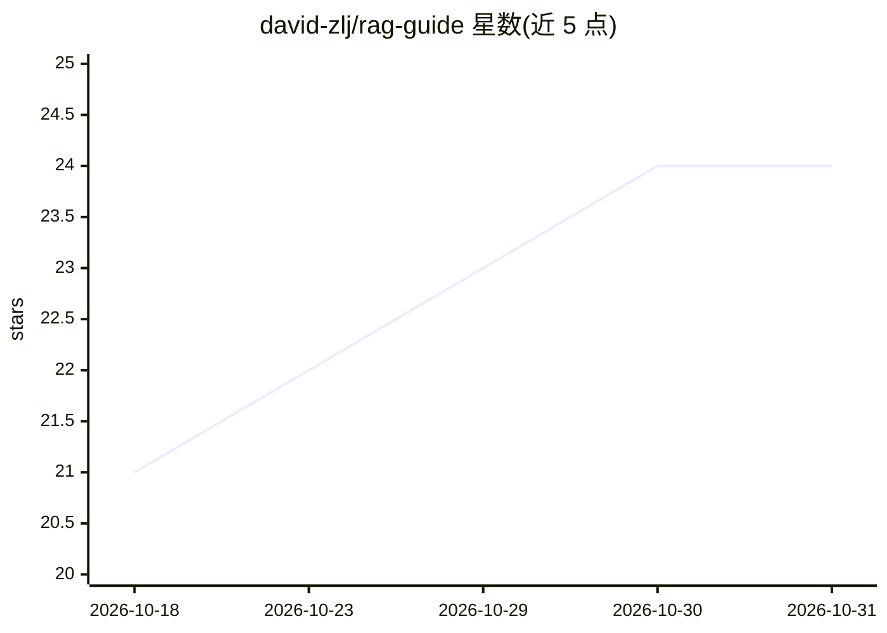

# david-zlj/rag-guide

⭐ 24 · Python · MIT · 推送 2026-02-24 · [GitHub](https://github.com/david-zlj/rag-guide) · [官网](https://rag.marsmgn.cn) · 个人维护 · 中文 README

**RAG 从入门到生产落地的中文学习手册，含 4 个实战项目**

面向 RAG 开发者的教学型项目：按学习路径组织 5 大模块，覆盖基础概念、核心组件实战（数据处理/嵌入/向量库/检索/生成）、LangChain 与 LlamaIndex 框架应用、4 个生产级项目（企业知识库问答、智能客服、论文问答、RAG+Agent 助手）及性能优化进阶。技术栈为 FastAPI + LangChain，大模型适配列举 Ollama、Xinference、OpenAI、腾讯混元、通义千问等，向量数据库支持 Milvus、Pinecone 等，部署适配 Docker/K8S。适用人群含新手、Python 工程师、产品经理与高校学生。

## 筛选速览

| 维度 | 判定 | 备注 |
|---|---|---|
| AI 角色 | `ai-knowledge` | 知识聚合/清单类 |
| 许可风险 | `permissive` | MIT |
| 部署形态 | `self-host` | docker 或自建部署 |
| 模型依赖 | — | README 未给出锁定关系 |
| 硬件要求 | — | 无带数字的原话,不猜 |
| 安装摩擦 | `low` | 无编译、无系统依赖或容器化 |
| 成熟度 | — | 结构信号不足 |

## 能力要点

- 5 大模块学习路径：基础→组件→框架→生产项目→性能优化
- 4 个生产级项目含需求分析到部署上线全流程
- 技术栈：FastAPI 异步架构 + LangChain 1.2.4 + Milvus/Pinecone
- 多模型适配：Ollama、Xinference 本地与 OpenAI、混元、通义千问等

## 适用场景

- 零基础系统学习 RAG 技术并动手实践
- 参考企业知识库、智能客服等项目模板落地业务
- 对比选型 LangChain 与 LlamaIndex 框架

## 场景标签

`RAG` `教程课程` · 领域:知识与检索

## 证据(README 行号)

> L6: 本项目定位为**RAG（Retrieval-Augmented Generation，检索增强生成）开发者的一站式手册**，旨在打破RAG技术学习中的“知识碎片化”和“理论与实践脱节”问题。
> L41: 本项目按“学习路径”分为5大模块，建议从第一模块开始逐步学习，也可根据自身基础直接跳转对应内容：

## 星数曲线

2026-10-18 21 → 2026-10-31 24（+3）

---
*卡片 v1 · prompt 1.4 · 生成 2026-10-27 · 置信度 mid · 依据 README sha `9251e8b73fe8` · [字段定义](../../DATASET.md)*
