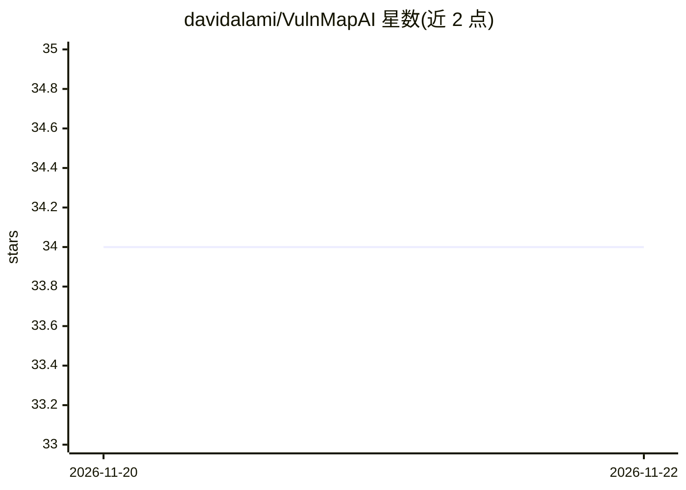

# davidalami/VulnMapAI

⭐ 34 · Python · MIT · 推送 2026-11-20 · [GitHub](https://github.com/davidalami/VulnMapAI) · 个人维护

**结合 nmap 扫描与 LLM 的漏洞报告生成工具**

将 nmap 网络扫描与 OpenAI 兼容的大语言模型端点结合，自动扫描目标系统并基于发现的服务与版本生成漏洞报告，提供潜在的 exploit 建议；可选与 Metasploit 集成搜索与验证 exploit。扫描默认只发现和排序候选模块，需显式传入 --authorize-module 才会执行版本确认且在允许清单内的模块。提供 Docker 运行方式与 Python 源码运行方式，面向 HackTheBox/TryHackMe 等授权靶场环境。

## 筛选速览

| 维度 | 判定 | 备注 |
|---|---|---|
| AI 角色 | `ai-native` | 本体是模型或模型工具 |
| 许可风险 | `permissive` | MIT |
| 部署形态 | `self-host` | docker 或自建部署 |
| 模型依赖 | local-ok | 支持本地模型 |
| 硬件要求 | — | 无带数字的原话,不猜 |
| 安装摩擦 | `low` | 无编译、无系统依赖或容器化 |
| 成熟度 | — | 结构信号不足 |

## 能力要点

- nmap 自动扫描与 LLM 报告生成结合
- 对接任意 OpenAI 兼容端点（vLLM/Ollama/LocalAI/LM Studio/OpenAI）
- Metasploit 集成搜索与验证 exploit
- 主动利用默认关闭，仅执行版本确认的允许清单内模块

## 适用场景

- 对 HackTheBox/TryHackMe 靶机做漏洞识别与报告
- 在授权渗透测试流程中辅助理解漏洞
- 开发者自托管模型生成漏洞分析报告

## 场景标签

`网络安全` · 领域:学习与行业

## 证据(README 行号)

> L2: VulnMapAI combines the power of nmap’s detailed network scanning with the natural language processing capabilities o
> L24: VulnMapAI talks to an **OpenAI-compatible Chat Completions endpoint**, so you can point it at any self-hosted model

## 星数曲线

2026-11-20 34 → 2026-11-22 34（+0）

---
*卡片 v1 · prompt 1.4 · 生成 2026-11-20 · 置信度 high · 依据 README sha `d3f6fa5cb31e` · [字段定义](../../DATASET.md)*
