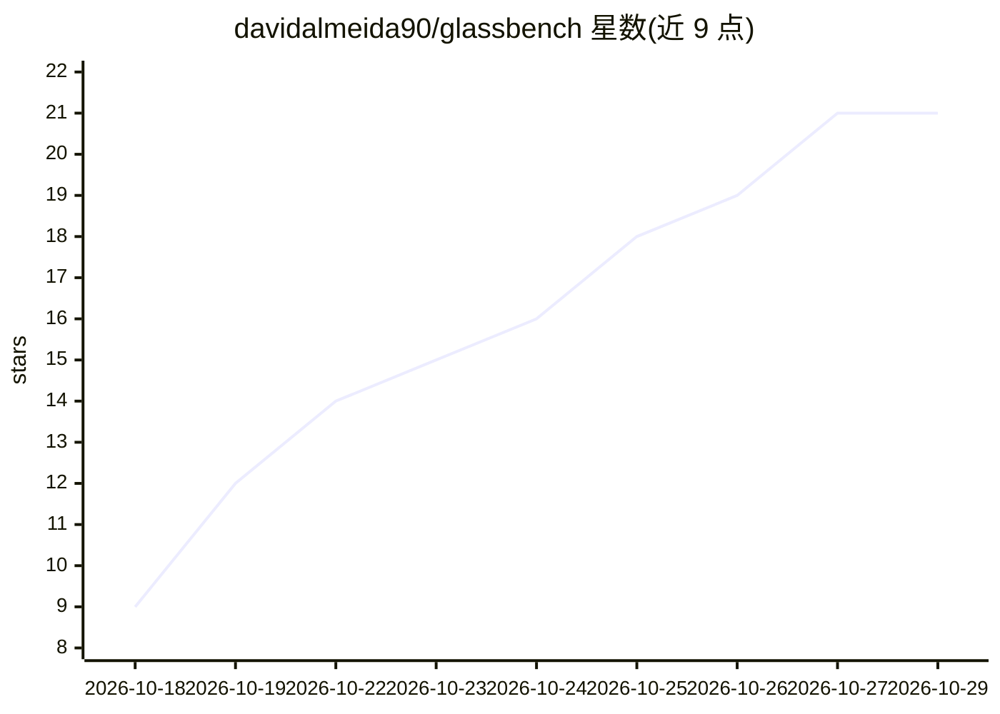

# davidalmeida90/glassbench

⭐ 21 · HTML · Apache-2.0 · 推送 2026-10-28 · [GitHub](https://github.com/davidalmeida90/glassbench) · [官网](https://davidariasfinance.com/glassbench/) · 个人维护

**连接并基准测试金融 agent 系统的开源平台，可接券商模拟盘**

将 TradingAgents、AI Hedge Fund 等金融 agent 框架通过适配器接入同一平台：在同一股票和日期上运行，逐卡展示各 agent 的阅读、论证与决策，记录每次 LLM 调用、工具调用与成本到 SQLite 数据库。支持多 provider（DeepSeek 默认，含本地 Ollama 等 12 家）做模型与框架对比，提供带交易成本的回测、变体对照（提示词/时点估值），并可将运行结果转为 Interactive Brokers 模拟账户的括号订单。仅限模拟交易，自述为研究与教育工具。需 Python 3.11+、Node 22+，从源码克隆安装。

## 筛选速览

| 维度 | 判定 | 备注 |
|---|---|---|
| AI 角色 | `ai-ecosystem` | LLM/agent 周边工具 |
| 许可风险 | `permissive` | Apache-2.0 |
| 部署形态 | `desktop` | 安装包/桌面程序 |
| 模型依赖 | local-ok | 支持本地模型 |
| 硬件要求 | — | 无带数字的原话,不猜 |
| 安装摩擦 | `low` | 无编译、无系统依赖或容器化 |
| 成熟度 | — | 结构信号不足 |

## 能力要点

- 多金融 agent 框架经单一适配器接入，引擎原样运行
- 每次运行的完整记录入库（SQLite）：模型、token、成本、全文检索、CSV 导出
- 多 provider 模型基准与命名变体对照（提示词/SEC EDGAR 时点估值）
- trade.py 将运行结果转为 Interactive Brokers 模拟账户括号订单

## 适用场景

- 在同一股票和日期上并排比较不同框架与模型的金融分析输出
- 回放和审计金融 agent 的每次调用、论证与决策过程
- 对 agent 评级方法做带成本的回测与安慰剂对照
- 把分析结果以模拟订单形式落到 Interactive Brokers 纸面账户

## 场景标签

`金融量化` `LLM 可观测性` `模型评测` · 领域:评测与运维

## 证据(README 行号)

> L14: Glassbench connects finance agent systems to one platform, runs them on the same stock and date, and records what t
> L18: - **Benchmark models and frameworks.** Pick the provider and type any model id; DeepSeek is the default, and OpenAI

## 星数曲线

2026-10-18 9 → 2026-10-29 21（+12）

---
*卡片 v1 · prompt 1.4 · 生成 2026-10-28 · 置信度 high · 依据 README sha `a467f5f2bab5` · [字段定义](../../DATASET.md)*
