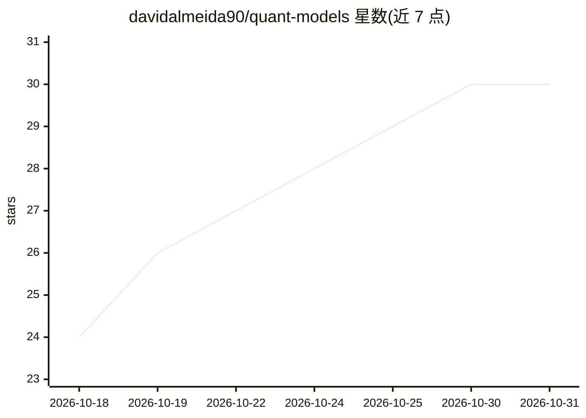

# davidalmeida90/quant-models

⭐ 30 · Python · MIT · 推送 2026-10-19 · [GitHub](https://github.com/davidalmeida90/quant-models) · 个人维护

**量化金融模型的开源 Python 实现集合：期权定价、波动率、组合与蒙特卡洛**

个人维护的量化金融代码库，实现 Black-Scholes 定价与 Greeks、GEX、Heston 波动率面、深度对冲、层次风险平价、均值方差优化、蒙特卡洛与二叉树等模型，配套网站文章与视频讲解。其中神经网络仅覆盖部分条目（MLP 学习 SPY 隐含波动率面、深度对冲网络），主体为解析式与数值方法。所有模型运行于免费数据（yfinance、Cboe 链、FRED）或模拟路径；通过 git clone 源码运行，MIT 许可，声明仅供教育研究用途。

## 筛选速览

| 维度 | 判定 | 备注 |
|---|---|---|
| AI 角色 | `ai-enhanced` | 去掉 AI 部分产品仍成立 |
| 许可风险 | `permissive` | MIT |
| 部署形态 | `None` |  |
| 模型依赖 | — | README 未给出锁定关系 |
| 硬件要求 | — | 无带数字的原话,不猜 |
| 安装摩擦 | `low` | 无编译、无系统依赖或容器化 |
| 成熟度 | — | 结构信号不足 |

## 能力要点

- 期权定价、Greeks、二/三阶希腊字母与隐含波动率实现
- 深度对冲网络与 numpy MLP 波动率面学习
- HRP/风险平价/最小方差等组合构建方法
- 全部模型基于免费数据或模拟路径，每个文件夹含可独立运行的 model.py

## 适用场景

- 学习并复现经典量化金融模型的教学与研究
- 分析期权链的 GEX 与对冲行为
- 比较多种风险配置与组合优化方法

## 场景标签

`金融量化` · 领域:学习与行业

## 证据(README 行号)

> L10: davidariasfinance.com: option pricing and Greeks, volatility
> L35: |Neural network vol surface|Two from-scratch numpy MLPs learn the SPY implied vol surface|real SPY chain, included|
> L36: |Deep hedging|A network learns to hedge a call spread, judged on tail risk|simulated paths|

## 星数曲线

2026-10-18 24 → 2026-10-31 30（+6）

---
*卡片 v1 · prompt 1.4 · 生成 2026-10-26 · 置信度 high · 依据 README sha `90d7585ec63a` · [字段定义](../../DATASET.md)*
