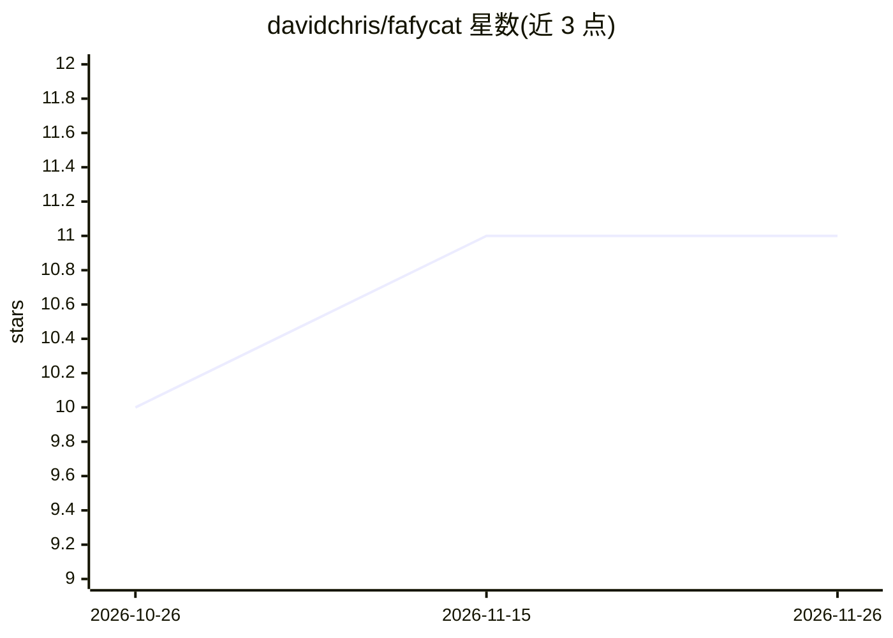

# davidchris/fafycat

⭐ 11 · Python · Apache-2.0 · 推送 2026-11-23 · [GitHub](https://github.com/davidchris/fafycat) · 个人维护

**本地机器学习分类银行交易 CSV 的隐私记账工具**

FafyCat 是一个本地优先的银行交易分类工具：导入银行 CSV 导出后，用本地训练的机器学习模型（基于 scikit-learn）预测交易类别，置信度高的自动接受，其余进入人工复核队列，并从用户修正中持续学习。数据完全保留在本地设备，无账户连接、无托管后端，Web UI 由本地进程在 127.0.0.1 提供。支持多种 CSV 布局与日期/金额格式，提供多种导出格式与预算/分析查询 CLI，并内置面向编码 agent 的只读 JSON CLI 与 Claude Code skill。面向有个人记账需求的用户。

## 筛选速览

| 维度 | 判定 | 备注 |
|---|---|---|
| AI 角色 | `ai-native` | 本体是模型或模型工具 |
| 许可风险 | `permissive` | Apache-2.0 |
| 部署形态 | `None` |  |
| 模型依赖 | — | README 未给出锁定关系 |
| 硬件要求 | — | 无带数字的原话,不猜 |
| 安装摩擦 | `low` | 无编译、无系统依赖或容器化 |
| 成熟度 | — | 结构信号不足 |

## 能力要点

- 本地 ML 模型从用户已复核历史中学习并预测交易类别
- 复核队列机制：低置信度预测按信息量排序供人工确认
- 本地优先：无托管后端，默认仅绑定 127.0.0.1 并带 CSRF/DNS rebinding 防护
- 面向编码 agent 的只读 JSON CLI 与一键安装的 Claude Code skill

## 适用场景

- 导入银行 CSV 后自动分类个人收支交易
- 复核并修正机器不确定的交易类别
- 把交易数据导出到自己习惯的分析工具

## 场景标签

 · 领域:个人理财/财务数据分析

## 证据(README 行号)

> L3: FafyCat is a privacy-focused financial transaction categorization tool that uses local machine learning to organize 
> L15: - **🤖 Smart Categorization**: Machine learning categorizes transactions from your own reviewed history
> L128: - **Local Processing**: All ML models run on your device

## 星数曲线

2026-10-26 10 → 2026-11-26 11（+1）

---
*卡片 v1 · prompt 1.4 · 生成 2026-11-18 · 置信度 high · 依据 README sha `34ee2d6975fa` · [字段定义](../../DATASET.md)*
