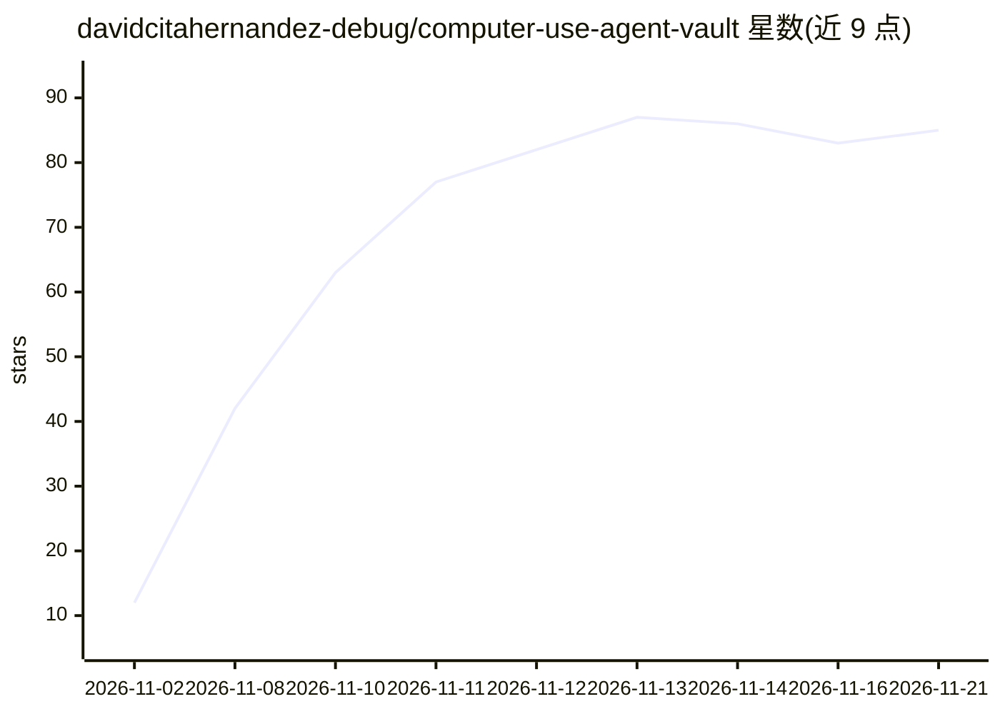

# davidcitahernandez-debug/computer-use-agent-vault

⭐ 85 · 推送 2026-11-02 · [GitHub](https://github.com/davidcitahernandez-debug/computer-use-agent-vault) · [官网](https://app.coregold.io/signup?invite_code=ADvlj9b) · 组织维护 · 中文 README

**面向自主 Agent 的虚拟卡支付沙箱方案宣传仓库（CoreGold）**

该仓库是一个推广 CoreGold 虚拟卡服务的 README 页面，而非可安装的软件：主张在让 AI Agent 操作浏览器执行注册、下单、支付网关测试等自动化任务前，为其派发一次性限额虚拟卡，实现与主资金链隔离。描述的机制包括预设额度拒付、单任务额度控制、商用 BIN 与 AVS 账单库以通过第三方风控。页面含 YAML 示例片段与开卡控制台链接，未提供本仓库代码的安装或运行方式。

## 筛选速览

| 维度 | 判定 | 备注 |
|---|---|---|
| AI 角色 | `ai-ecosystem` | LLM/agent 周边工具 |
| 许可风险 | `none` | — |
| 部署形态 | `None` |  |
| 模型依赖 | — | README 未给出锁定关系 |
| 硬件要求 | — | 无带数字的原话,不猜 |
| 安装摩擦 | `low` | 无编译、无系统依赖或容器化 |
| 成熟度 | — | 结构信号不足 |

## 能力要点

- 核心主张：为 Agent 派发一次性限额虚拟卡以隔离支付风险
- 描述的机制包括额度锁死拒付、单任务额度、Tier-1 商用 BIN 与 AVS 账单库
- 以 Claude 3.7 Computer Use 类自主 Agent 场景为背景（仅提及，无专门接入适配）

## 适用场景

- 让 Agent 自动化下单或测试支付网关时控制损失上限
- 隔离 Agent 远程沙箱中的支付凭证

## 场景标签

 · 领域:支付服务/Agent 基础设施

## 证据(README 行号)

> L9: 一旦 Agent 逻辑发生幻觉、误入钓鱼结算页、或者死循环重复提交表单，实体信用卡几万刀额度会在几秒内被彻底穿透。拿 **CoreGold** 给每个 Agent 派发一张一次性限额卡，才是自动化时代的唯一合规解法。
> L11: 👉 **立即直达 CoreGold 开卡控制台**

## 星数曲线

2026-11-02 12 → 2026-11-21 85（+73）

---
*卡片 v1 · prompt 1.4 · 生成 2026-11-18 · 置信度 low · 依据 README sha `dbf38f894045` · [字段定义](../../DATASET.md)*
