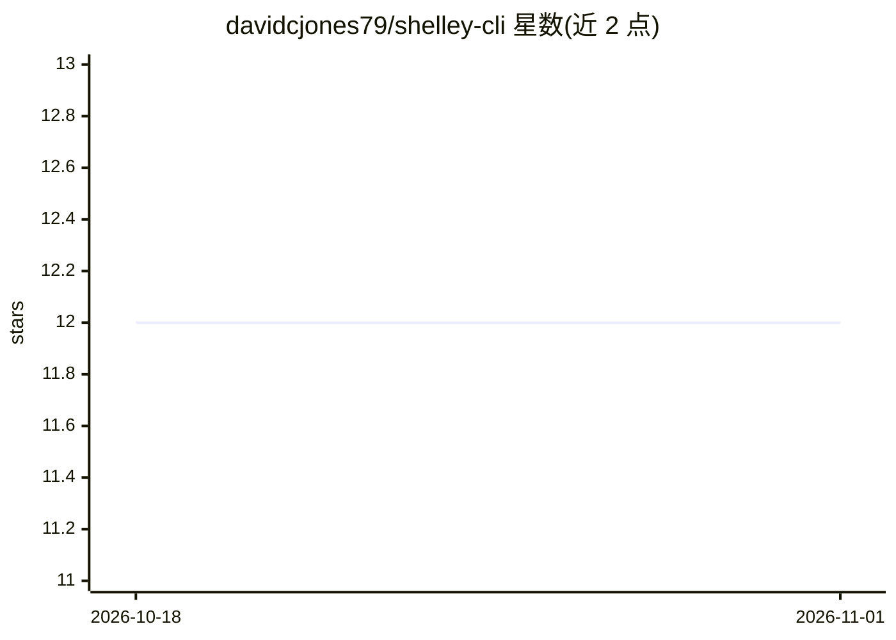

# davidcjones79/shelley-cli

⭐ 12 · Go · NOASSERTION · 推送 2026-01-18 · [GitHub](https://github.com/davidcjones79/shelley-cli) · 个人维护

**Shelley 编码 agent 的终端界面 fork，含分布式任务与文件传输**

boldsoftware/shelley 的 fork，为其编码 agent 增加终端 CLI（流式输出、工具执行、会话同步）、Igor 文件传输服务、Coordinator 分布式任务队列（可跨多台 VM 并行、worker 可克隆仓库并推送 feature 分支）及 /pick 文件分析工作流。后端 Go、SQLite 存储，前端 TypeScript/React。支持 Anthropic、OpenAI、Fireworks 模型，exe.dev VM 上可用内置 LLM 网关免 API key。Apache 2.0 许可。

## 筛选速览

| 维度 | 判定 | 备注 |
|---|---|---|
| AI 角色 | `ai-native` | 本体是模型或模型工具 |
| 许可风险 | `none` | NOASSERTION |
| 部署形态 | `desktop` | 安装包/桌面程序 |
| 模型依赖 | locked-api |  |
| 硬件要求 | — | 无带数字的原话,不猜 |
| 安装摩擦 | `low` | 无编译、无系统依赖或容器化 |
| 成熟度 | — | 结构信号不足 |

## 能力要点

- 跨多 VM 的 Coordinator 分布式任务队列与 worker 池
- Igor 文件传输服务与 /pick 文件分析命令
- CLI/Web 双模式，会话同步与工具执行
- 支持 Anthropic/OpenAI/Fireworks 多家模型切换

## 适用场景

- 在终端里通过对话让 agent 完成编码任务
- 把编码任务分发到多台 VM 并行执行
- 上传文件并通过 /pick 快速分析

## 场景标签

`编码 Agent` · 领域:编码与开发

## 证据(README 行号)

> L3: > A terminal interface for Shelley, the coding agent. This fork adds CLI, Igor file transfer, Coordinator for distri
> L92: Shelley is a mobile-friendly, web-based, multi-conversation, multi-modal,
> L193: |Anthropic|claude-opus-4.5, claude-sonnet-4.5, claude-haiku-4.5|

## 星数曲线

2026-10-18 12 → 2026-11-01 12（+0）

---
*卡片 v1 · prompt 1.4 · 生成 2026-11-01 · 置信度 high · 依据 README sha `fa3f7ba83a28` · [字段定义](../../DATASET.md)*
