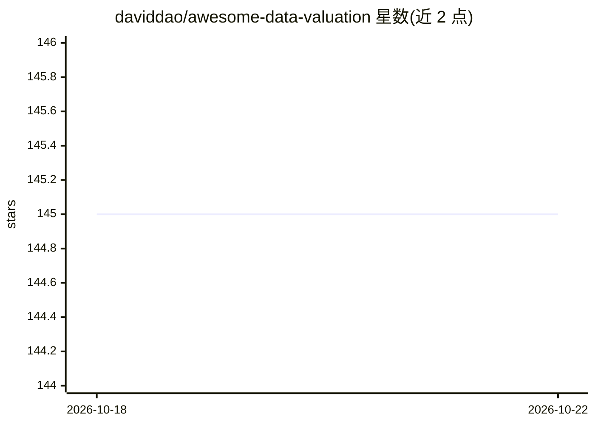

# daviddao/awesome-data-valuation

⭐ 145 · MIT · 推送 2026-08-14 · [GitHub](https://github.com/daviddao/awesome-data-valuation) · 个人维护

**数据估值（Data Valuation）论文与方法的策展清单**

由个人维护的 awesome 类清单，收录数据估值（DV）方向的论文条目：围绕 Shapley 值与合作博弈论展开，覆盖 Data Shapley、Beta Shapley、Data Banzhaf、分布式 Shapley、类间贡献区分等估值框架，以及面向最近邻等模型的高效估计算法。每个条目给出论文摘要与 Bibtex，部分标注有可用代码（💻）或演讲幻灯片（🎥）。定位为设计数据市场与可解释 AI 时查找估值方法与文献参考的入口，不提供可安装的软件本体。

## 筛选速览

| 维度 | 判定 | 备注 |
|---|---|---|
| AI 角色 | `ai-knowledge` | 知识聚合/清单类 |
| 许可风险 | `permissive` | MIT |
| 部署形态 | `None` |  |
| 模型依赖 | — | README 未给出锁定关系 |
| 硬件要求 | — | 无带数字的原话,不猜 |
| 安装摩擦 | `low` | 无编译、无系统依赖或容器化 |
| 成熟度 | — | 结构信号不足 |

## 能力要点

- 按 Shapley 值/合作博弈论与高效算法等主题组织论文条目
- 每条含摘要与 Bibtex，部分标注代码或演讲材料
- 覆盖 2019–2024 年的数据估值方法（Data Shapley、Beta Shapley、Data Banzhaf 等）

## 适用场景

- 设计数据市场前调研数据估值方法
- 查找有开源实现的数据估值论文
- 为数据估值研究获取 Bibtex 引用与文献脉络

## 场景标签

`精选清单` · 领域:学习与行业

## 证据(README 行号)

> L5: 💱 A curated list of data valuation (DV) to design your next data marketplace. DV aims to understand the value of a d
> L16: ### Shapley Value & Cooperative Game Theory

## 星数曲线

2026-10-18 145 → 2026-10-22 145（+0）

---
*卡片 v1 · prompt 1.4 · 生成 2026-10-22 · 置信度 high · 依据 README sha `f77ef06b1ad1` · [字段定义](../../DATASET.md)*
