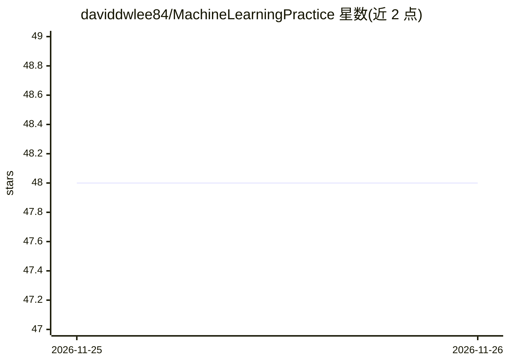

# daviddwlee84/MachineLearningPractice

⭐ 48 · Python · 推送 2026-11-23 · [GitHub](https://github.com/daviddwlee84/MachineLearningPractice) · 个人维护 · 中文 README

**统计机器学习实践笔记：从零实现算法并配套资源清单**

个人学习仓库，基于公开数据集练习统计机器学习技术，包含 20 余个项目条目，每项给出任务、数据集与解法（From Scratch 实现与 sklearn/PyTorch 等对照），覆盖 kNN、决策树、SVM、AdaBoost、聚类、PCA/SVD、HMM 等。正文按学习任务、模型类别、ML 概念与数学基础组织笔记，并附书籍、教程、数据集、竞赛与工具的推荐清单。环境为 Python 3.11+，依赖用 uv 管理，另有 Google Colab 运行说明。

## 筛选速览

| 维度 | 判定 | 备注 |
|---|---|---|
| AI 角色 | `ai-knowledge` | 知识聚合/清单类 |
| 许可风险 | `none` | — |
| 部署形态 | `library` | 以包/库形式分发 |
| 模型依赖 | — | README 未给出锁定关系 |
| 硬件要求 | — | 无带数字的原话,不猜 |
| 安装摩擦 | `low` | 无编译、无系统依赖或容器化 |
| 成熟度 | — | 结构信号不足 |

## 能力要点

- kNN、决策树、SVM、AdaBoost 等算法的 From Scratch 实现并与 sklearn 对照
- 项目表覆盖分类、回归、聚类、降维、推荐系统与 NLP 任务
- 按学习任务/模型/概念/数学组织的学习笔记体系
- 附书籍、教程、数据集、竞赛与 AutoML 工具资源清单

## 适用场景

- 按项目表逐个练习经典 ML 算法的从零实现
- 查阅某个算法（如 SVM、FP-Growth）的推导笔记与数据集
- 寻找机器学习书籍、课程与竞赛资源的索引

## 场景标签

`教程课程` `精选清单` · 领域:学习与行业

## 证据(README 行号)

> L3: Some practices using statistical machine learning technique based on some dataset.
> L56: ## Projects
> L280: ## Books Recommendation

## 星数曲线

2026-11-25 48 → 2026-11-26 48（+0）

---
*卡片 v1 · prompt 1.4 · 生成 2026-11-24 · 置信度 mid · 依据 README sha `228d209fc4c5` · [字段定义](../../DATASET.md)*
