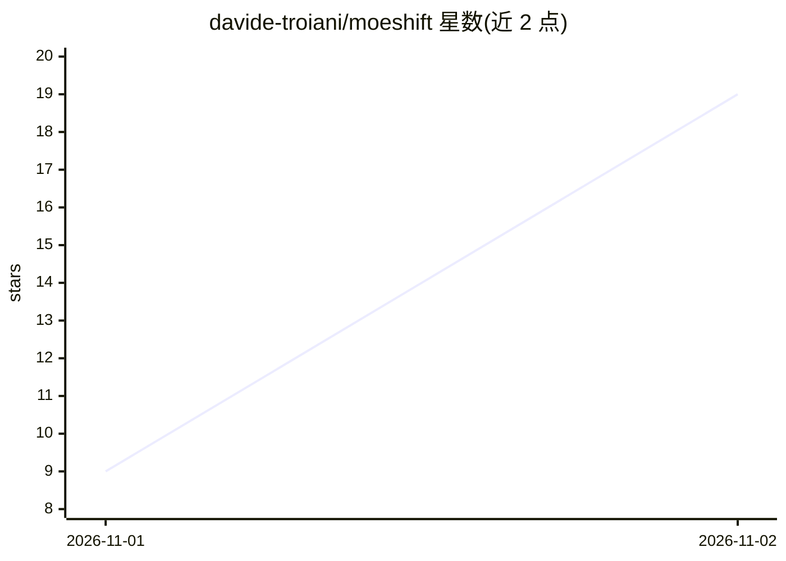

# davide-troiani/moeshift

⭐ 19 · C++ · MIT · 推送 2026-10-30 · [GitHub](https://github.com/davide-troiani/moeshift) · 个人维护

**在 10GB 内存 Apple Silicon Mac 上本地运行 125B MoE 模型的推理服务器**

面向 Apple Silicon Mac 的 Mixture-of-Experts 本地推理运行时，基于 llama.cpp / ggml / llama.cpp-omni 构建，采用 LES（Lookahead Expert Scheduling）、专家文件 SSD 直读与 Metal 执行，在 24GB 统一内存的 Mac mini M4 Pro 上以约 6.4-7.5GB 峰值进程内存运行 Qwen 3.8 Flash Next（125B，IQ3_XXS 量化）。通过 Homebrew 安装，启动后提供 localhost:8080 的 OpenAI 兼容 API，可接入聊天/编程客户端。当前为 Alpha 版，一次处理一个推理请求，仅监听 localhost，模型文件约 76GB 需自行下载并完成约 43GB 的专家提取准备。

## 筛选速览

| 维度 | 判定 | 备注 |
|---|---|---|
| AI 角色 | `ai-ecosystem` | LLM/agent 周边工具 |
| 许可风险 | `permissive` | MIT |
| 部署形态 | `None` |  |
| 模型依赖 | — | README 未给出锁定关系 |
| 硬件要求 | — | 无带数字的原话,不猜 |
| 安装摩擦 | `low` | 无编译、无系统依赖或容器化 |
| 成熟度 | `idea` | |

## 能力要点

- 10GB RAM 起步运行 125B 参数 MoE 模型，峰值进程内存 6.4-7.5GB
- LES 专家调度 + 专家文件 SSD 直读 + Metal 执行
- 提供 OpenAI 兼容本地 API（127.0.0.1:8080/v1）
- 提供专家缓存、上下文长度、线程等速度/内存调节配置

## 适用场景

- 在小内存 Mac mini/MacBook 上本地运行超大参数 MoE 模型
- 把本地模型接入支持 OpenAI 兼容 API 的聊天或编程客户端
- 推理时保持其他应用可用的低内存占用本地推理

## 场景标签

`推理引擎` · 领域:训练与推理

## 证据(README 行号)

> L127: Leave this Terminal open. MoEShift starts a local server at
> L143: In any client that supports an OpenAI-compatible API, enter:
> L227: MoEShift builds on tc-mb/llama.cpp-omni,

## 星数曲线

2026-11-01 9 → 2026-11-02 19（+10）

---
*卡片 v1 · prompt 1.4 · 生成 2026-11-02 · 置信度 high · 依据 README sha `b790b709de2a` · [字段定义](../../DATASET.md)*
