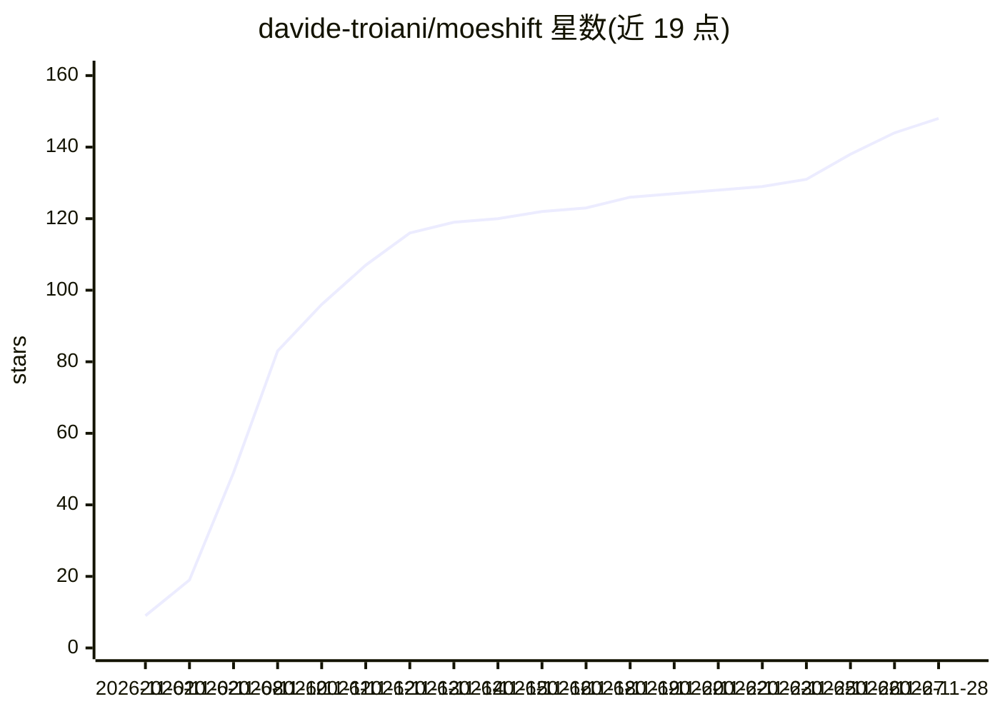

# davide-troiani/moeshift

⭐ 148 · C++ · MIT · 推送 2026-11-24 · [GitHub](https://github.com/davide-troiani/moeshift) · 个人维护

**Apple Silicon 上以 SSD 流式读取运行的 MoE 本地大模型推理服务器**

面向 Apple Silicon Mac 的本地大模型推理工具：将完整 MoE 模型放在 SSD 上，运行时按需读取所需部分，使内存小于模型体积的 Mac 也能运行本地模型并释放内存给其他应用。提供安装向导下载三个预设模型，启动 localhost 服务器，暴露 OpenAI 兼容 API（一次处理一个推理请求）。README 给出 M5/M5 Pro 上的基准数据；要求至少 10 GB 内存、快速 SSD 与 Homebrew。基于 llama.cpp-omni/llama.cpp/ggml 构建。

## 筛选速览

| 维度 | 判定 | 备注 |
|---|---|---|
| AI 角色 | `ai-ecosystem` | LLM/agent 周边工具 |
| 许可风险 | `permissive` | MIT |
| 部署形态 | `None` |  |
| 模型依赖 | — | README 未给出锁定关系 |
| 硬件要求 | — | 无带数字的原话,不猜 |
| 安装摩擦 | `low` | 无编译、无系统依赖或容器化 |
| 成熟度 | — | 结构信号不足 |

## 能力要点

- SSD 流式读取，使模型体积可超过物理内存
- OpenAI 兼容 API（http://127.0.0.1:8080/v1）
- 安装向导提供三个预设模型及 SSD 空间需求表
- 内置基准测试并可分享结果

## 适用场景

- 在 24 GB 内存的 MacBook 上本地运行 125B 级 MoE 模型
- 作为编码 Agent（如 OpenCode）或 API 客户端的后端
- 边运行本地助手边保留内存给编辑器/浏览器

## 场景标签

`推理引擎` · 领域:训练与推理

## 证据(README 行号)

> L3: **Run a local language model that’s bigger than your Mac’s memory.**
> L39: and starts a localhost server that handles one inference request at a time.
> L41: Configure your coding agent or API client with the OpenAI-compatible base URL

## 星数曲线

2026-11-01 9 → 2026-11-28 148（+139）

---
*卡片 v1 · prompt 1.4 · 生成 2026-11-27 · 置信度 high · 依据 README sha `2df778599bab` · [字段定义](../../DATASET.md)*
