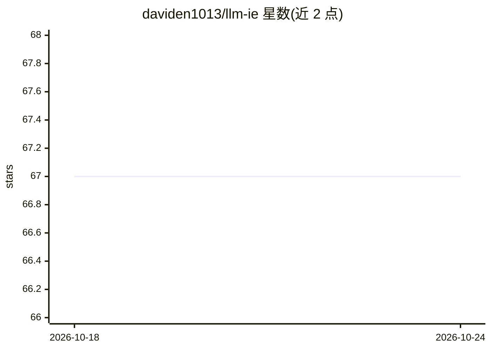

# daviden1013/llm-ie

⭐ 67 · Python · 推送 2026-08-19 · [GitHub](https://github.com/daviden1013/llm-ie) · [官网](https://daviden1013.github.io/llm-ie/) · 个人维护

**基于 LLM 的命名实体/属性/关系抽取工具包**

Python 工具包 LLM-IE，为构建 LLM 驱动的信息抽取流水线提供建筑模块：命名实体识别（可定制句级/文档级粒度）、实体属性抽取（二元与多类关系）及非实体结构化数据抽取。核心机制是将文档切分为单元（UnitChunker）并提供上下文窗口（ContextChunker），逐单元提示 LLM，支持并发处理与异步抽取；附带 LLM Agent 交互式编写提示模板、文档管理与 Flask 可视化，另有 Docker 部署的拖拽式 Web 应用。需自备至少一个推理引擎（vLLM/Ollama/OpenAI 等），包本身不安装引擎。有配套论文与文档站。

## 筛选速览

| 维度 | 判定 | 备注 |
|---|---|---|
| AI 角色 | `ai-native` | 本体是模型或模型工具 |
| 许可风险 | `none` | — |
| 部署形态 | `self-host` | docker 或自建部署 |
| 模型依赖 | local-ok | 支持本地模型 |
| 硬件要求 | — | 无带数字的原话,不猜 |
| 安装摩擦 | `low` | 无编译、无系统依赖或容器化 |
| 成熟度 | — | 结构信号不足 |

## 能力要点

- NER/属性抽取/关系抽取构建块，粒度与格式可定制
- 单元分块 + 滑动窗口上下文的逐单元提示机制，支持并发与异步
- LLM Agent 交互式编写提示模板（Prompt Editor）
- Docker 部署的无代码拖拽式 Web 应用与内置可视化

## 适用场景

- 从医学等文本中抽取实体、属性与关系并可视化
- 批量文档的并发信息抽取流水线
- 通过 Web 应用无代码完成 LLM 信息抽取

## 场景标签

`文档解析` · 领域:知识与检索

## 证据(README 行号)

> L6: A comprehensive toolkit that provides building blocks for LLM-based named entity recognition, attribute extraction, 
> L11: |**Named Entity Recognition (NER)**|:white_check_mark: Customizable granularity (e.g., sentence-level, document-lev
> L13: |**Relation Extraction (RE)**|:white_check_mark: Binary & Multiclass relations|

## 星数曲线

2026-10-18 67 → 2026-10-24 67（+0）

---
*卡片 v1 · prompt 1.4 · 生成 2026-10-24 · 置信度 high · 依据 README sha `430ba5719609` · [字段定义](../../DATASET.md)*
