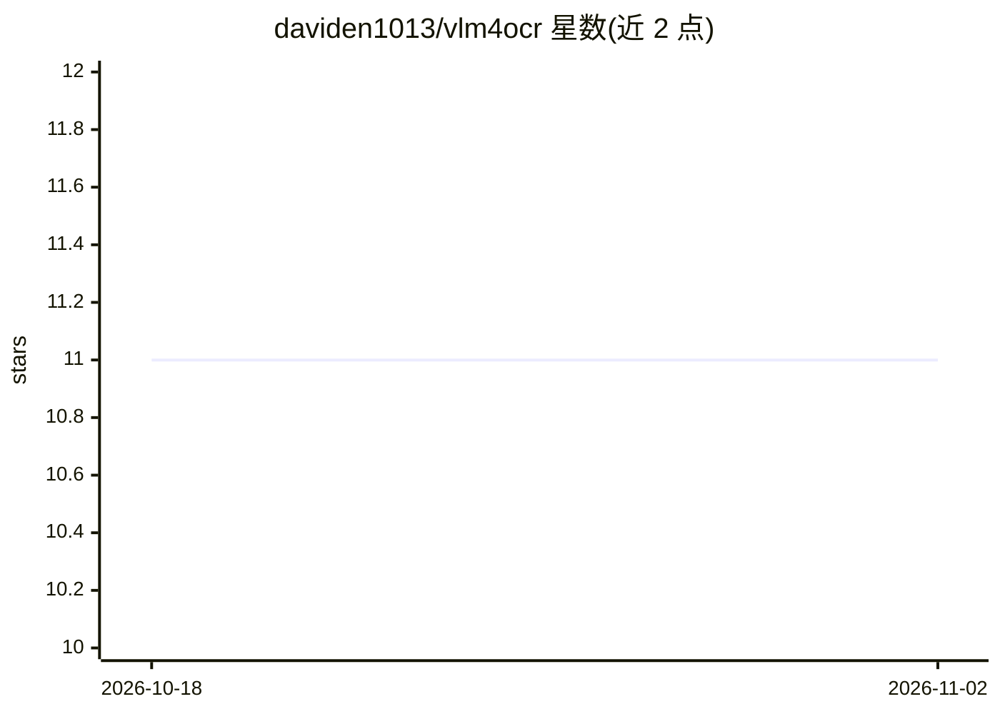

# daviden1013/vlm4ocr

⭐ 11 · Python · MIT · 推送 2026-10-06 · [GitHub](https://github.com/daviden1013/vlm4ocr) · 个人维护

**用视觉语言模型做 OCR 的 Python 包、CLI 与 Web 应用**

vlm4ocr 提供以视觉语言模型（VLM）为引擎的 OCR 能力，形式包括 Python 包、CLI 和 Flask Web 应用（支持拖拽上传、实时流式输出、批量并发处理）。支持 PDF/TIFF/PNG/JPG 等文件类型，输出 Markdown、HTML、纯文本、JSON 及带边界框的 BBox 模式，可按自由文本指令做定向信息抽取，并提供少样本示例与逐页路由管线。VLM 引擎覆盖 Ollama、OpenAI/Azure、vLLM、SGLang 等 OpenAI 兼容端点；PDF 渲染后端（pypdfium2/pdf2image/pymupdf）需自选安装，无默认值。

## 筛选速览

| 维度 | 判定 | 备注 |
|---|---|---|
| AI 角色 | `ai-native` | 本体是模型或模型工具 |
| 许可风险 | `permissive` | MIT |
| 部署形态 | `self-host` | docker 或自建部署 |
| 模型依赖 | local-ok | 支持本地模型 |
| 硬件要求 | — | 无带数字的原话,不猜 |
| 安装摩擦 | `low` | 无编译、无系统依赖或容器化 |
| 成熟度 | — | 结构信号不足 |

## 能力要点

- Ollama/OpenAI/Azure/vLLM/SGLang 等多种 VLM 推理引擎
- BBox 输出模式：文本附边界框坐标与标签，支持定向抽取
- Python/CLI/Web 应用三种使用方式，支持并发批量处理
- IndependentPagePipeline 对异构文档逐页分类路由到不同 prompt/schema

## 适用场景

- 把扫描文档批量转成 Markdown/JSON 文本
- 从表单或报告图片中定向抽取关键字段并输出结构化 JSON
- 不写代码，通过 Web 界面拖拽完成 OCR

## 场景标签

`OCR` `文档解析` · 领域:知识与检索

## 证据(README 行号)

> L5: Vision Language Models (VLMs) for Optical Character Recognition (OCR).
> L45: `vlm4ocr` provides a simple way to perform OCR using the power of modern Vision Language Models (VLMs). A drag-and-
> L10: |**VLM Engines**|:white_check_mark: Ollama, OpenAI Compatible (vLLM, SGLang, OpenRouter), OpenAI, Azure OpenAI|

## 星数曲线

2026-10-18 11 → 2026-11-02 11（+0）

---
*卡片 v1 · prompt 1.4 · 生成 2026-11-02 · 置信度 high · 依据 README sha `f82e8c6920b8` · [字段定义](../../DATASET.md)*
