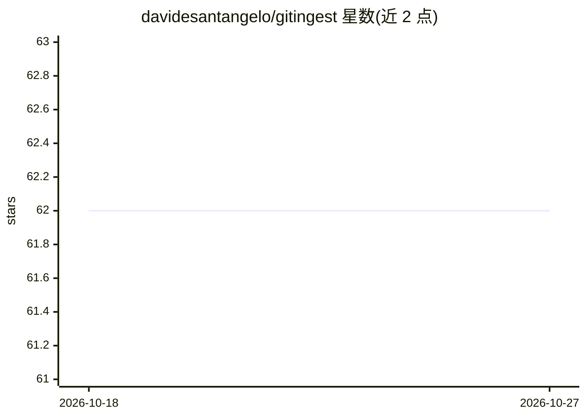

# davidesantangelo/gitingest

⭐ 62 · Ruby · MIT · 推送 2025-12-05 · [GitHub](https://github.com/davidesantangelo/gitingest) · [官网](https://davidesantangelo.github.io/gitingest/) · 个人维护

**把 GitHub 仓库转为 LLM 提示文本的命令行工具**

Ruby 编写的 CLI 工具，通过 GitHub API 抓取指定仓库（user/repo）的文件，生成合并的文本提示供 LLM 使用。支持指定分支、GitHub token、排除模式、目录树展示、多线程与静默/详细模式，也可作为 Ruby 库调用。限制包括每仓库最多 1000 个文件、无 token 时每小时 60 次请求（有 token 5000 次）、私有仓库需 token。灵感来自 cyclotruc/gitingest，MIT 许可。

## 筛选速览

| 维度 | 判定 | 备注 |
|---|---|---|
| AI 角色 | `ai-ecosystem` | LLM/agent 周边工具 |
| 许可风险 | `permissive` | MIT |
| 部署形态 | `None` |  |
| 模型依赖 | — | README 未给出锁定关系 |
| 硬件要求 | — | 无带数字的原话,不猜 |
| 安装摩擦 | `low` | 无编译、无系统依赖或容器化 |
| 成熟度 | — | 结构信号不足 |

## 能力要点

- 拉取 GitHub 仓库文件并生成合并的 LLM 提示文本
- 支持分支选择、排除模式、token 认证与多线程
- 可作 CLI 或 Ruby 库使用

## 适用场景

- 把任意 GitHub 仓库整理成单段文本喂给 LLM
- 配合 token 处理私有仓库或提高请求配额
- 在 Ruby 程序中以库形式集成仓库文本化能力

## 场景标签

`网页抓取` · 领域:效率与自动化

## 证据(README 行号)

> L5: Turn any GitHub repo into an LLM-ready prompt.
> L10: gem install gitingest

## 星数曲线

2026-10-18 62 → 2026-10-27 62（+0）

---
*卡片 v1 · prompt 1.4 · 生成 2026-10-24 · 置信度 high · 依据 README sha `54a05fde4512` · [字段定义](../../DATASET.md)*
