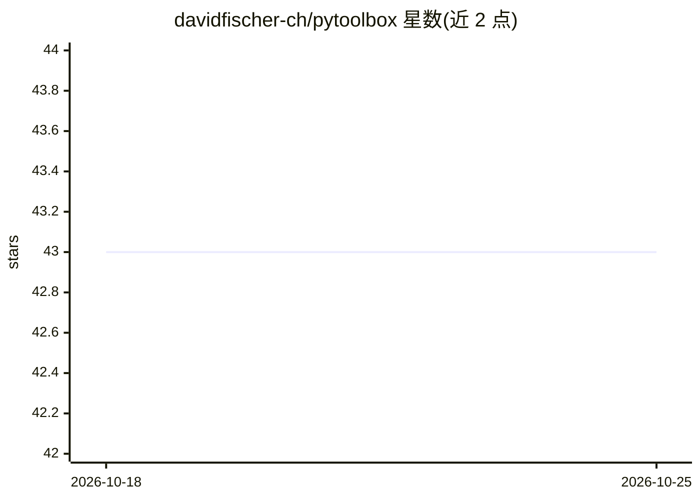

# davidfischer-ch/pytoolbox

⭐ 43 · Python · NOASSERTION · 推送 2026-10-23 · [GitHub](https://github.com/davidfischer-ch/pytoolbox) · 个人维护

**给 Python 开发者的通用脚本工具箱库**

面向 Python 脚本开发者的通用工具库，覆盖子进程调用等日常工具函数，全部代码带类型注解（Python 3.10+ 语法），测试于 Python 3.12/3.13（3.11 尽力支持）。通过 setup.py extras 机制按需启用约 19 个功能模块，包括 Django/DRF、Flask、AWS、Selenium、影像处理（EXIF，依赖 gexiv2）、视觉（依赖 dlib，需编译工具链）等。安装前需先用 apt 装若干系统库（libxml2、ffmpeg 等），再以 pip 安装并选择 extras。文档由 Sphinx 生成，采用语义化版本。

## 筛选速览

| 维度 | 判定 | 备注 |
|---|---|---|
| AI 角色 | `ai-enhanced` | 去掉 AI 部分产品仍成立 |
| 许可风险 | `none` | NOASSERTION |
| 部署形态 | `library` | 以包/库形式分发 |
| 模型依赖 | — | README 未给出锁定关系 |
| 硬件要求 | — | 无带数字的原话,不猜 |
| 安装摩擦 | `high` | 编译与系统依赖俱全 |
| 成熟度 | — | 结构信号不足 |

## 能力要点

- setup.py extras 按需启用 Django/Flask/AWS/影像/视觉等约 19 个模块
- 全代码库带类型注解（Python 3.10+ 语法），兼容 mypy/pyright
- 支持 Python 3.12/3.13，3.11 为尽力支持
- 视觉功能通过 dlib 提供，需 build-essential/cmake 编译环境

## 适用场景

- 在 Python 脚本中复用子进程、影像 EXIF 读取等工具函数
- 作为依赖库集成到自己的 setup.py 项目中
- 按项目技术栈选择性地启用 Django/Flask 等集成模块

## 场景标签

 · 领域:软件开发/Python 工具库

## 证据(README 行号)

> L14: This module is a Toolbox for Python scripts.
> L105:  --extra-vision Install dependencies for Vision.

## 星数曲线

2026-10-18 43 → 2026-10-25 43（+0）

---
*卡片 v1 · prompt 1.4 · 生成 2026-10-25 · 置信度 mid · 依据 README sha `54736f582307` · [字段定义](../../DATASET.md)*
