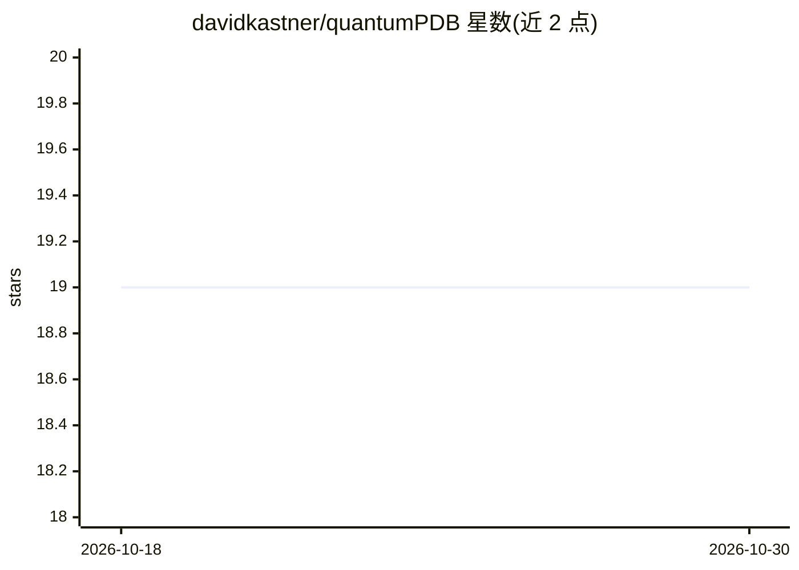

# davidkastner/quantumPDB

⭐ 19 · Python · MIT · 推送 2026-02-25 · [GitHub](https://github.com/davidkastner/quantumPDB) · [官网](https://quantumpdb.readthedocs.io/) · 组织维护

**为蛋白质量子化学数据库搭建 DFT 计算与簇模型的工作流工具包**

quantumPDB (qp) 是一个 Python 工具包，围绕蛋白质数据库工作：读取 PDB ID 列表，按 config.yaml 配置生成 DFT 计算的簇模型与数据集文件结构。全部功能组织为命令行接口 `qp`，通过 `qp run -c ./config.yaml` 运行。安装采用开发者模式：克隆仓库后用 conda environment.yml 建环境并 pip -e 安装，兼容 Python 3.8+。README 自述仍在处理边缘情况（如非标准氨基酸），mmCIF 支持尚未加入。

## 筛选速览

| 维度 | 判定 | 备注 |
|---|---|---|
| AI 角色 | `ai-enhanced` | 去掉 AI 部分产品仍成立 |
| 许可风险 | `permissive` | MIT |
| 部署形态 | `library` | 以包/库形式分发 |
| 模型依赖 | — | README 未给出锁定关系 |
| 硬件要求 | — | 无带数字的原话,不猜 |
| 安装摩擦 | `low` | 无编译、无系统依赖或容器化 |
| 成熟度 | — | 结构信号不足 |

## 能力要点

- 以 CLI 形式组织全部功能，`qp run` 按 config.yaml 批量处理 PDB ID
- 为 DFT 计算与簇模型创建生成输入数据集
- 提供 environment.yml 依赖环境文件，兼容 Python 3.8+

## 适用场景

- 批量从 PDB 条目生成 DFT 计算的簇模型输入
- 构建带量子化学计算属性的蛋白质数据集

## 场景标签

 · 领域:计算化学/结构生物学

## 证据(README 行号)

> L7: The purpose of quantumPDB (qp) is to serve as a toolkit for working with our database of proteins to setup and facil
> L34: All of the functionality of quantumPDB has been organized into a command-line interface (CLI).

## 星数曲线

2026-10-18 19 → 2026-10-30 19（+0）

---
*卡片 v1 · prompt 1.4 · 生成 2026-10-28 · 置信度 low · 依据 README sha `f690e24f70d1` · [字段定义](../../DATASET.md)*
