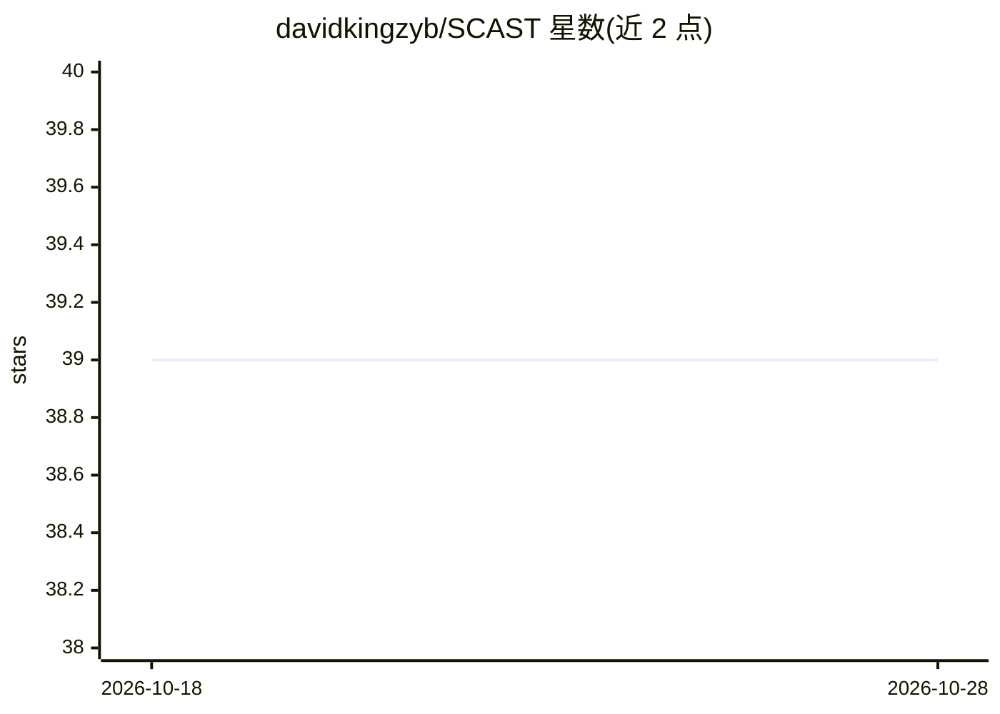

# davidkingzyb/SCAST

⭐ 39 · JavaScript · MIT · 推送 2026-05-08 · [GitHub](https://github.com/davidkingzyb/SCAST) · [官网](https://davidkingzyb.github.io/scast/SCAST.html) · 个人维护 · 中文 README

**静态代码分析可视化工具：代码转 UML/流程图并用 AI 解释**

SCAST 将源代码解析为抽象语法树（AST）并做静态分析，用 Mermaid 与 D3 生成 UML 图、AST 树图与流程图，支持 C#/JS/Python/TS/C/C++ 等语言，可经 TreeSitter 扩展语言。提供浏览器打开 SCAST.html 的零安装用法、npm 部署服务器，以及 MCP server 模式接入 AI 客户端；附带 scast_analysis 与 scast_retriever 两个工具（后者以关键词检索源码定义，配合 RAG 式问答）。AI 解释功能依赖另装的 Ollama，本体不装 Ollama 也可完成可视化分析。

## 筛选速览

| 维度 | 判定 | 备注 |
|---|---|---|
| AI 角色 | `ai-enhanced` | 去掉 AI 部分产品仍成立 |
| 许可风险 | `permissive` | MIT |
| 部署形态 | `library` | 以包/库形式分发 |
| 模型依赖 | local-ok | 支持本地模型 |
| 硬件要求 | — | 无带数字的原话,不猜 |
| 安装摩擦 | `low` | 无编译、无系统依赖或容器化 |
| 成熟度 | — | 结构信号不足 |

## 能力要点

- 解析代码为 AST 并生成 UML/AST 树图/Mermaid 流程图
- 内置 6 种语言，可经 TreeSitter 扩展或自定义语言
- MCP server 模式提供 scast_analysis 与 scast_retriever 两个工具
- 可选接入 Ollama 由 AI 解释代码功能

## 适用场景

- 我想把项目代码变成 UML 图和流程图来理解结构
- 让 AI 客户端通过 MCP 调用代码分析能力
- 为代码问答（RAG）提供关键词与定义检索

## 场景标签

 · 领域:开发工具/代码分析

## 证据(README 行号)

> L9: 🔱SCAST is a programmatic tool that converts code into UML diagrams and flowcharts.
> L24: The underlying principle involves leveraging a parser to parse the code into an Abstract Syntax Tree (AST), followe
> L59: #### Ollama AI

## 星数曲线

2026-10-18 39 → 2026-10-28 39（+0）

---
*卡片 v1 · prompt 1.4 · 生成 2026-10-25 · 置信度 high · 依据 README sha `9265f202a281` · [字段定义](../../DATASET.md)*
