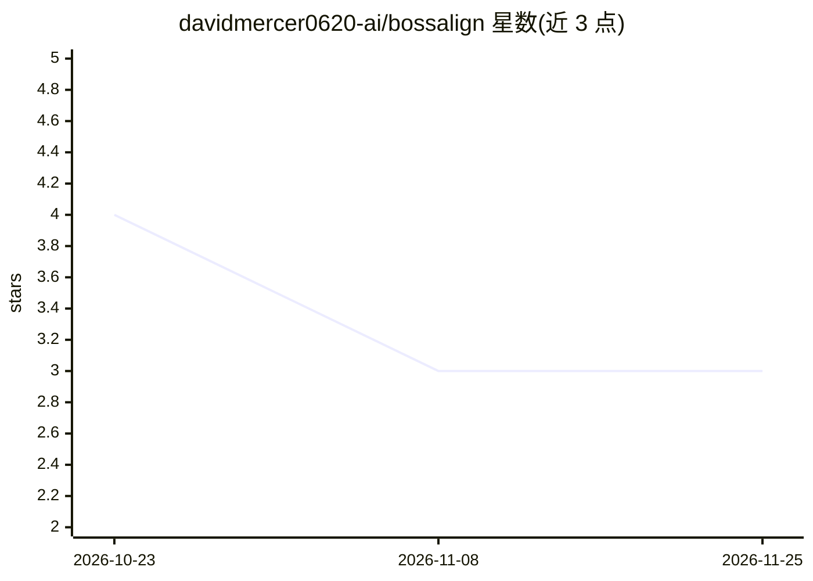

# davidmercer0620-ai/bossalign

⭐ 3 · Python · MIT · 推送 2026-10-21 · [GitHub](https://github.com/davidmercer0620-ai/bossalign) · 个人维护 · 中文 README

**把人类纠正固化为带范围规则并校准执行的 Agent 对齐引擎**

位于 agent 记忆与行为之间的框架无关层：将反馈存储为带证据、范围与排除边界的规则提案，按任务上下文检索并检查适配规则，规则有草稿/确认/停用生命周期与版本历史，持久化于本地 SQLite。V0.3 增加校准闭环：记录人工裁定，计算 precision/recall/过泛化率等指标，策略变更需通过升级门控。离线解析为启发式（英/中线索），可配置 OpenAI 兼容 provider 做更广语义解释，结果仍需人工确认。面向为 AI agent 构建记忆/行为的开发者。

## 筛选速览

| 维度 | 判定 | 备注 |
|---|---|---|
| AI 角色 | `ai-ecosystem` | LLM/agent 周边工具 |
| 许可风险 | `permissive` | MIT |
| 部署形态 | `library` | 以包/库形式分发 |
| 模型依赖 | — | README 未给出锁定关系 |
| 硬件要求 | — | 无带数字的原话,不猜 |
| 安装摩擦 | `low` | 无编译、无系统依赖或容器化 |
| 成熟度 | — | 结构信号不足 |

## 能力要点

- 规则带证据、范围与否定边界，支持草稿/确认/停用生命周期与版本历史
- 敏感反馈默认本地优先，存储与外部处理均需显式同意
- 校准闭环：人工裁定→指标测量→阈值推导→策略升级门控
- CLI 与 Python SDK 共享同一事件存储与检查引擎

## 适用场景

- 防止 AI agent 在无关任务上泛化某次局部纠正
- 对偏好规则的执行效果做 precision/recall 校准后再更新策略
- 团队/工作场景偏好以可审计、可撤销的方式持久化

## 场景标签

`Agent 记忆` `模型评测` · 领域:Agent 开发

## 证据(README 行号)

> L10: BossAlign (蛔虫引擎) is a small, framework-independent layer between agent memory and agent behavior. It stores correct
> L112: The SDK accepts a provider object. The included adapter uses the OpenAI Chat Completions-compatible request shape 
> L106: Commands: `ingest`, `rules`, `check`, `export`, `replay`, `demo`, `sanitize`, and `calibrate`. Check exit codes ar

## 星数曲线

2026-10-23 4 → 2026-11-25 3（-1）

---
*卡片 v1 · prompt 1.4 · 生成 2026-11-22 · 置信度 mid · 依据 README sha `2aeea3039194` · [字段定义](../../DATASET.md)*
