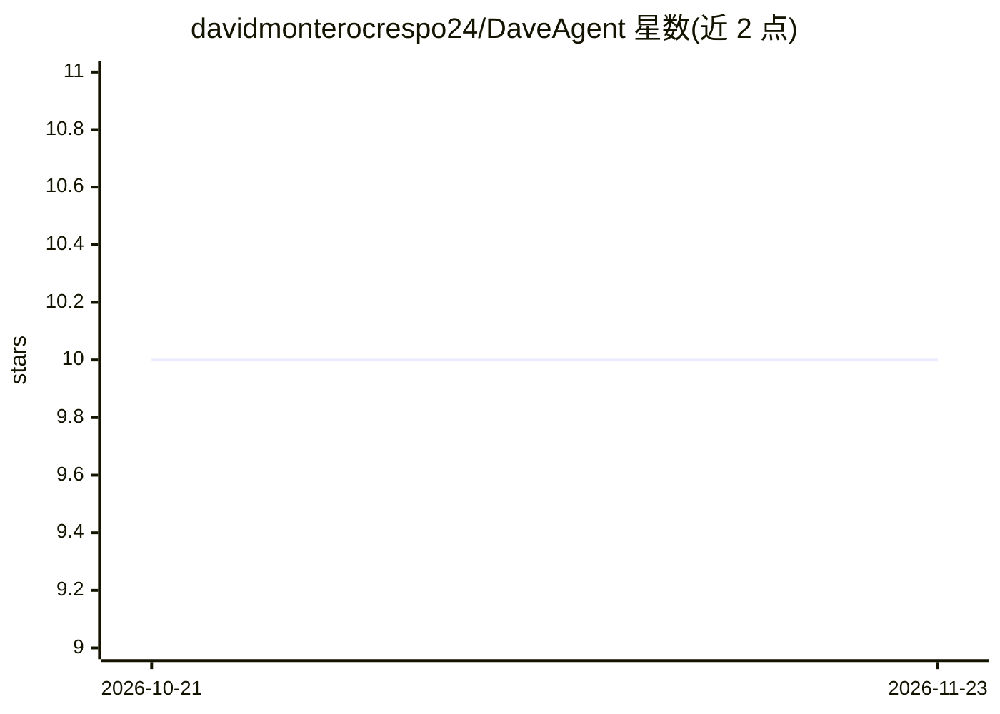

# davidmonterocrespo24/DaveAgent

⭐ 10 · Python · MIT · 推送 2026-03-11 · [GitHub](https://github.com/davidmonterocrespo24/DaveAgent) · [官网](https://daveplanet.com) · 个人维护

**基于 AutoGen 的终端 AI 编码助手：在当前目录协助开发任务**

以 CLI 命令 `daveagent` 在用户当前目录运行的编码助手，使用 AutoGen 0.4 编排专职 agent，内置 CodeSearcher 代码检索分析 agent、ChromaDB 向量记忆（跨会话保留对话与决策）、45+ 集成工具（文件系统、Git、JSON、CSV、Web、RAG 记忆），支持 @ 文件提及提高上下文优先级。默认使用 DeepSeek API，可通过编辑 main.py 或环境变量改用其他模型。提供 PyPI 安装与源码安装，附带基于 SWE-bench Verified 的 Linux 评估脚本（需 Docker）。

## 筛选速览

| 维度 | 判定 | 备注 |
|---|---|---|
| AI 角色 | `ai-native` | 本体是模型或模型工具 |
| 许可风险 | `permissive` | MIT |
| 部署形态 | `library` | 以包/库形式分发 |
| 模型依赖 | locked-api |  |
| 硬件要求 | — | 无带数字的原话,不猜 |
| 安装摩擦 | `low` | 无编译、无系统依赖或容器化 |
| 成熟度 | — | 结构信号不足 |

## 能力要点

- AutoGen 0.4 编排专职 agent，自动选择合适 agent
- ChromaDB 向量记忆跨会话保留对话、代码与决策
- CodeSearcher 代码搜索 agent 与 @ 文件上下文机制
- 45+ 集成工具：文件系统、Git、JSON、CSV、Web、RAG

## 适用场景

- 在项目目录里用自然语言搜索与分析代码
- 让助手先分析现有代码再生成新文件并保持一致性
- 用自然语言完成 CSV/JSON 数据转换处理
- 运行 SWE-bench Verified 评估 agent 表现

## 场景标签

`编码 Agent` `Agent 记忆` · 领域:Agent 开发

## 证据(README 行号)

> L7: DaveAgent is an intelligent AI-powered coding assistant that works in your current directory. It uses AutoGen 0.4 to
> L16: - 🔧 **45+ Integrated Tools**: Filesystem, Git, JSON, CSV, Web, Memory (RAG), and more
> L205: DaveAgent uses DeepSeek by default. To change the model:

## 星数曲线

2026-10-21 10 → 2026-11-23 10（+0）

---
*卡片 v1 · prompt 1.4 · 生成 2026-11-19 · 置信度 high · 依据 README sha `e29f7e27e7b9` · [字段定义](../../DATASET.md)*
