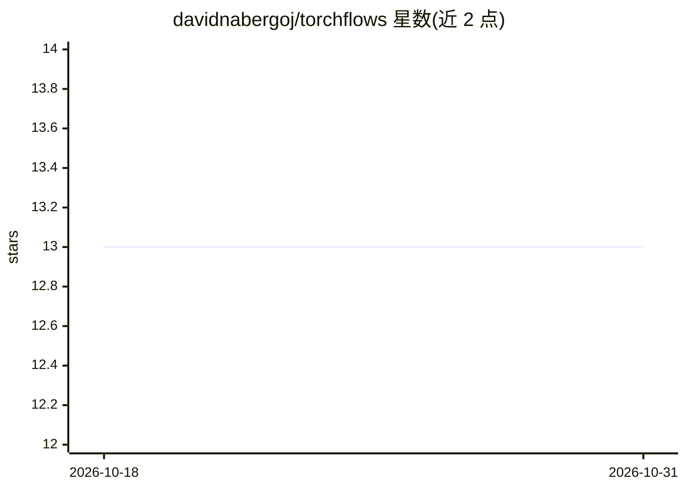

# davidnabergoj/torchflows

⭐ 13 · Python · MIT · 推送 2026-10-28 · [GitHub](https://github.com/davidnabergoj/torchflows) · [官网](https://torchflows.readthedocs.io/en/latest/) · 个人维护

**PyTorch 归一化流库：生成建模与密度估计**

基于 PyTorch 的归一化流库，实现多种 normalizing flow 架构及其构建模块，定位为可训练分布的易用接口与新架构的易实现框架。通过 Flow 类等 API 使用 RealNVP 等架构完成生成建模与密度估计。支持 Python 3.9 及以上，经 pip 安装或从 GitHub 源码安装，提供开发环境配置说明、文档与测试，附有随附论文的引用请求。

## 筛选速览

| 维度 | 判定 | 备注 |
|---|---|---|
| AI 角色 | `ai-native` | 本体是模型或模型工具 |
| 许可风险 | `permissive` | MIT |
| 部署形态 | `library` | 以包/库形式分发 |
| 模型依赖 | — | README 未给出锁定关系 |
| 硬件要求 | — | 无带数字的原话,不猜 |
| 安装摩擦 | `low` | 无编译、无系统依赖或容器化 |
| 成熟度 | — | 结构信号不足 |

## 能力要点

- 实现多种归一化流架构及其构建模块
- 归一化流作为可训练分布的易用接口
- 支持新归一化流架构的便捷实现
- 提供示例、文档与自动化测试

## 适用场景

- 在 PyTorch 项目中做生成建模与密度估计
- 实现并试验新的归一化流架构
- 科研工作中随附论文配套的流模型实验

## 场景标签

 · 领域:机器学习/生成模型

## 证据(README 行号)

> L10: Torchflows is a library for generative modeling and density estimation using normalizing flows.
> L13: * Easy use of normalizing flows as trainable distributions.

## 星数曲线

2026-10-18 13 → 2026-10-31 13（+0）

---
*卡片 v1 · prompt 1.4 · 生成 2026-10-31 · 置信度 high · 依据 README sha `d4b261fcd909` · [字段定义](../../DATASET.md)*
