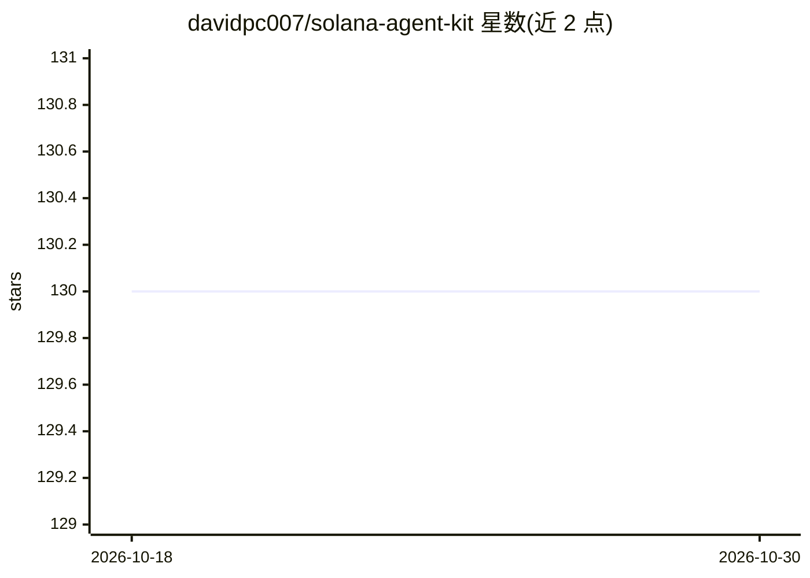

# davidpc007/solana-agent-kit

⭐ 130 · TypeScript · Apache-2.0 · 推送 2026-09-14 · [GitHub](https://github.com/davidpc007/solana-agent-kit) · 组织维护

**TypeScript 工具包：让 AI agent 执行 Solana 链上操作**

模块化 monorepo 形式的 TypeScript 工具包，为 AI agent 提供统一接口执行 Solana 链上操作：代币转账、DeFi 交互、NFT 管理、跨链桥接等 60+ 协议动作。采用插件架构按需安装协议包，提供 LangChain、Vercel AI SDK、OpenAI Agents、Claude 及 MCP 适配器，支持 Keypair/Open Wallet Standard 等钱包方式，可选 Redis 持久化缓存（不可用时内存回退）。面向在自有技术栈中接入 Solana 的开发者。

## 筛选速览

| 维度 | 判定 | 备注 |
|---|---|---|
| AI 角色 | `ai-ecosystem` | LLM/agent 周边工具 |
| 许可风险 | `permissive` | Apache-2.0 |
| 部署形态 | `library` | 以包/库形式分发 |
| 模型依赖 | locked-api |  |
| 硬件要求 | — | 无带数字的原话,不猜 |
| 安装摩擦 | `low` | 无编译、无系统依赖或容器化 |
| 成熟度 | — | 结构信号不足 |

## 能力要点

- 60+ 协议动作覆盖代币、DeFi、NFT、跨链等类别
- 插件架构，通过 .use() 链式组合按需安装协议包
- LangChain/Vercel AI/OpenAI/Claude/MCP 多适配器，暴露相同底层 actions
- 可选 Redis 持久化缓存，含 stale-while-revalidate 与内存回退

## 适用场景

- 为我的 LangChain 或 Vercel AI agent 添加 Solana 链上操作能力
- 按需组合插件构建特定协议的 DeFi/NFT agent
- 通过 MCP 适配器把 Solana 工具接入其他 agent 框架

## 场景标签

`Agent 框架` · 领域:Agent 开发

## 证据(README 行号)

> L3: Production-ready TypeScript toolkit for connecting AI agents to Solana blockchain protocols. Built as a modular mono
> L7: Solana Agent Kit provides a unified interface for AI agents to perform on-chain operations — token transfers, DeFi i

## 星数曲线

2026-10-18 130 → 2026-10-30 130（+0）

---
*卡片 v1 · prompt 1.4 · 生成 2026-10-22 · 置信度 high · 依据 README sha `7c8247934b17` · [字段定义](../../DATASET.md)*
