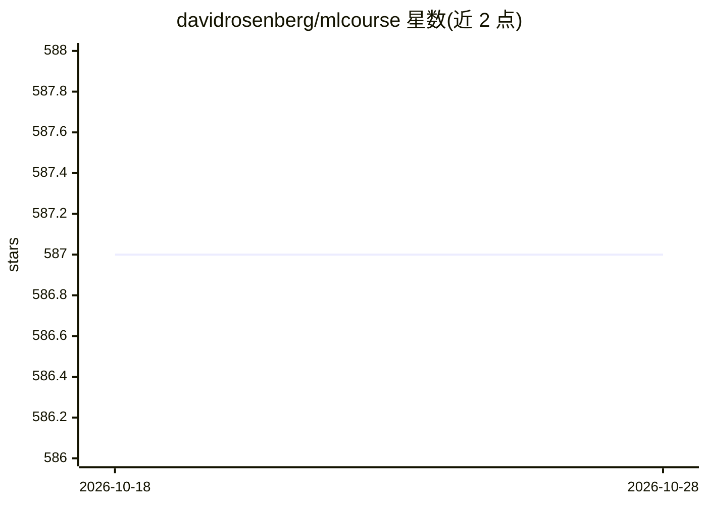

# davidrosenberg/mlcourse

⭐ 587 · Jupyter Notebook · 推送 2026-06-24 · [GitHub](https://github.com/davidrosenberg/mlcourse) · [官网](https://davidrosenberg.github.io/ml2018) · 个人维护

**机器学习课程讲义与作业库：面向学生的教学材料**

由 David Rosenberg 维护的机器学习课程资料仓库，内容以讲义（SVM、核方法、EM 算法、梯度提升、变分推断、表征定理、弹性网等主题）、书面作业与编程作业（lasso、逻辑回归、反向传播等）为主。README 主体是 2015-2018 年间的课程内容变更记录和一份待补充主题清单（高斯过程、变分自编码器、主题模型、强化学习等）。整库采用 CC BY 4.0 许可，各文档作者持有相应文档版权。不提供软件安装或运行方式。

## 筛选速览

| 维度 | 判定 | 备注 |
|---|---|---|
| AI 角色 | `ai-knowledge` | 知识聚合/清单类 |
| 许可风险 | `none` | — |
| 部署形态 | `None` |  |
| 模型依赖 | — | README 未给出锁定关系 |
| 硬件要求 | — | 无带数字的原话,不猜 |
| 安装摩擦 | `low` | 无编译、无系统依赖或容器化 |
| 成熟度 | — | 结构信号不足 |

## 能力要点

- 覆盖 SVM、核方法、EM、梯度提升、贝叶斯方法等主题的讲义与作业
- README 记录 2015-2018 年逐版课程内容变更
- 附未来可选主题清单（高斯过程、VAE、LDA、强化学习等）
- 整库 CC BY 4.0 许可，按文档作者持有版权

## 适用场景

- 系统学习机器学习理论与配套作业
- 查阅 SVM 对偶、EM 变分视角等具体专题的推导讲义
- 参考课程设计中的作业与编程题安排

## 场景标签

`教程课程` · 领域:学习与行业

## 证据(README 行号)

> L15: - Significant improvement of the programming problem for lasso regression in Homework #2.
> L40: - New lecture on **multiclass classification** and an intro to **structured prediction**
> L103: Creative Commons License Machine Learning Course Materials by Various Authors is licensed under a Creative Commons

## 星数曲线

2026-10-18 587 → 2026-10-28 587（+0）

---
*卡片 v1 · prompt 1.4 · 生成 2026-10-21 · 置信度 high · 依据 README sha `b4fb1e24aed3` · [字段定义](../../DATASET.md)*
