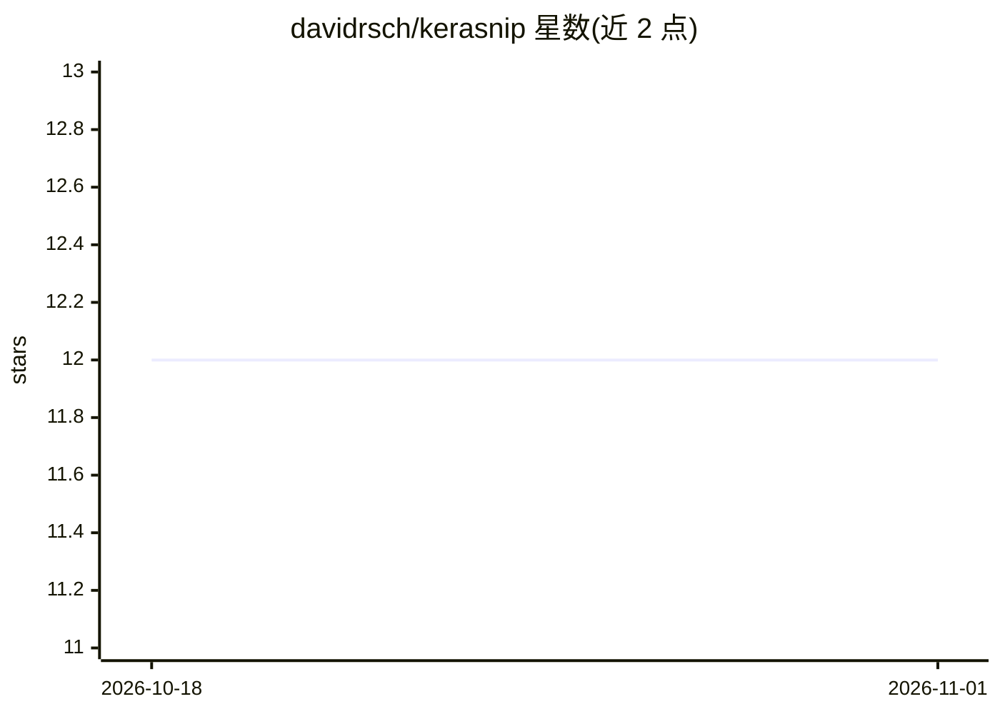

# davidrsch/kerasnip

⭐ 12 · R · NOASSERTION · 推送 2026-09-03 · [GitHub](https://github.com/davidrsch/kerasnip) · [官网](https://davidrsch.github.io/kerasnip/) · 个人维护

**连接 Keras 与 tidymodels 的 R 桥接包**

R 语言的模型规格桥接库：提供 create_keras_sequential_spec() 与 create_keras_functional_spec() 等函数，动态生成 Keras 模型的 parsnip 模型规格，使其纳入 tidymodels 工作流，支持 Sequential 与 Functional（分叉-拼接）架构，并可在同一调优过程中同时调整网络结构与模块超参数。面向使用 R 进行深度学习建模的用户，通过 GitHub 以 pak 安装开发版。

## 筛选速览

| 维度 | 判定 | 备注 |
|---|---|---|
| AI 角色 | `ai-ecosystem` | LLM/agent 周边工具 |
| 许可风险 | `none` | NOASSERTION |
| 部署形态 | `None` |  |
| 模型依赖 | — | README 未给出锁定关系 |
| 硬件要求 | — | 无带数字的原话,不猜 |
| 安装摩擦 | `low` | 无编译、无系统依赖或容器化 |
| 成熟度 | — | 结构信号不足 |

## 能力要点

- 动态生成 Keras 模型的 parsnip 模型规格
- 支持 Sequential 与 Functional（fork-join）架构
- 支持同时调优架构超参数与模块超参数

## 适用场景

- 在 tidymodels 工作流中训练 Keras 深度学习模型
- 用 R 构建并调优非线性的分叉-拼接网络架构
- 对层数、dropout 率等结构参数做统一调优

## 场景标签

 · 领域:机器学习工具/R 包

## 证据(README 行号)

> L10: The goal of `kerasnip` is to provide a seamless bridge between the `keras` and `tidymodels` frameworks. It allows f
> L25: This example shows the core workflow for building a simple, linear stack of layers using `create_keras_sequential_s

## 星数曲线

2026-10-18 12 → 2026-11-01 12（+0）

---
*卡片 v1 · prompt 1.4 · 生成 2026-11-01 · 置信度 high · 依据 README sha `6002fa647893` · [字段定义](../../DATASET.md)*
