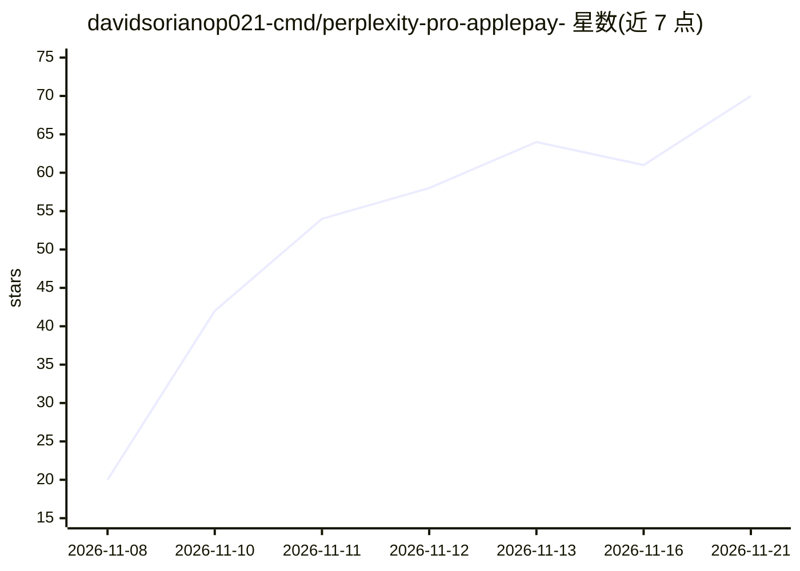

# davidsorianop021-cmd/perplexity-pro-applepay-

⭐ 70 · 推送 2026-11-04 · [GitHub](https://github.com/davidsorianop021-cmd/perplexity-pro-applepay-) · [官网](https://app.coregold.io/signup?invite_code=ADvlj9b) · 个人维护 · 中文 README

**Perplexity Pro 订阅支付避坑指南与 CoreGold 开卡教程**

一篇指南类文档而非软件项目：说明 Perplexity Pro 订阅（$20/月）在结算环节遇到 Stripe Radar 拦截、AVS 地址验证失败与预授权验资问题的成因，并提供两种解决通道：网页端填写 CoreGold 虚拟卡卡号与北美 AVS 地址完成绑定，或在 iPhone/Mac 钱包中导入该卡后经 Apple Pay 扣款。文末导向 CoreGold 开卡控制台，需以 USDT 充值开卡。

## 筛选速览

| 维度 | 判定 | 备注 |
|---|---|---|
| AI 角色 | `ai-knowledge` | 知识聚合/清单类 |
| 许可风险 | `none` | — |
| 部署形态 | `None` |  |
| 模型依赖 | — | README 未给出锁定关系 |
| 硬件要求 | — | 无带数字的原话,不猜 |
| 安装摩擦 | `low` | 无编译、无系统依赖或容器化 |
| 成熟度 | — | 结构信号不足 |

## 能力要点

- 梳理 Stripe Radar、AVS 验证与首充预授权三类拒付成因
- 提供网页直绑与 Apple Pay 两种订阅支付通道
- 说明 CoreGold 商业卡段开卡与充值流程

## 适用场景

- 国内双币卡订阅 Perplexity Pro 被拒付时寻找支付通道
- 需要北美账单地址完成 AVS 验证的订阅场景

## 场景标签

`教程课程` · 领域:学习与行业

## 证据(README 行号)

> L3: # ⚡ 别让支付卡死深度调研！Perplexity Pro 订阅避坑与 Apple Pay 双通道实测
> L32: ### 三、双通道部署方案（网页直绑 / Apple Pay）

## 星数曲线

2026-11-08 20 → 2026-11-21 70（+50）

---
*卡片 v1 · prompt 1.4 · 生成 2026-11-18 · 置信度 mid · 依据 README sha `0c8c9be8d27c` · [字段定义](../../DATASET.md)*
