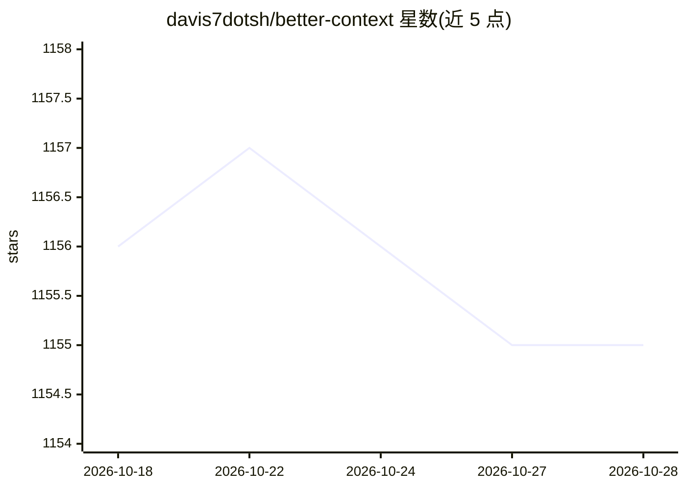

# davis7dotsh/better-context

⭐ 1,155 · TypeScript · MIT · 推送 2026-04-12 · [GitHub](https://github.com/davis7dotsh/better-context) · [官网](https://btca.dev) · 个人维护

**让编码 Agent 通过搜索库源码获取最新上下文的技能**

btca 是一个安装到编码 Agent（如 pi、codex）中的技能：Agent 在回答关于库和框架的问题时，不再依赖可能过时的文档，而是克隆并搜索相关仓库的实际源码（存放在 ~/.btca/agent/sandbox），以提升输出质量。用户可在提示中说 "use btca"、用 "/btc" 或 "$btc" 调用，也可附带提问。项目作者声明正在围绕 pi agent 和 node 重写，当前本地版本以技能形式提供，另有 Web 应用持续维护。通过 npx skills 命令安装。

## 筛选速览

| 维度 | 判定 | 备注 |
|---|---|---|
| AI 角色 | `ai-ecosystem` | LLM/agent 周边工具 |
| 许可风险 | `permissive` | MIT |
| 部署形态 | `library` | 以包/库形式分发 |
| 模型依赖 | — | README 未给出锁定关系 |
| 硬件要求 | — | 无带数字的原话,不猜 |
| 安装摩擦 | `low` | 无编译、无系统依赖或容器化 |
| 成熟度 | `idea` | |

## 能力要点

- Agent 回答库/框架问题时搜索实际源码而非文档
- 克隆的重要仓库存放在 ~/.btca/agent/sandbox
- 三种调用方式：提示中说明、斜杠/美元命令、附带提问
- 另有持续维护的 Web 版本（btca.dev）

## 适用场景

- 编码 Agent 回答库用法问题时引用真实源码
- 避免文档过时导致的错误回答
- 在本地为 Agent 提供目标库的可搜索副本

## 场景标签

`Agent 框架` · 领域:Agent 开发

## 证据(README 行号)

> L7: Ask your AI agent questions about libraries and frameworks by searching the actual source code, not outdated docs.
> L27: 1. install the skill: `npx skills add https://github.com/davis7dotsh/better-context --skill btca-local`

## 星数曲线

2026-10-18 1,156 → 2026-10-28 1,155（-1）

---
*卡片 v1 · prompt 1.4 · 生成 2026-10-21 · 置信度 high · 依据 README sha `36ba9f796024` · [字段定义](../../DATASET.md)*
