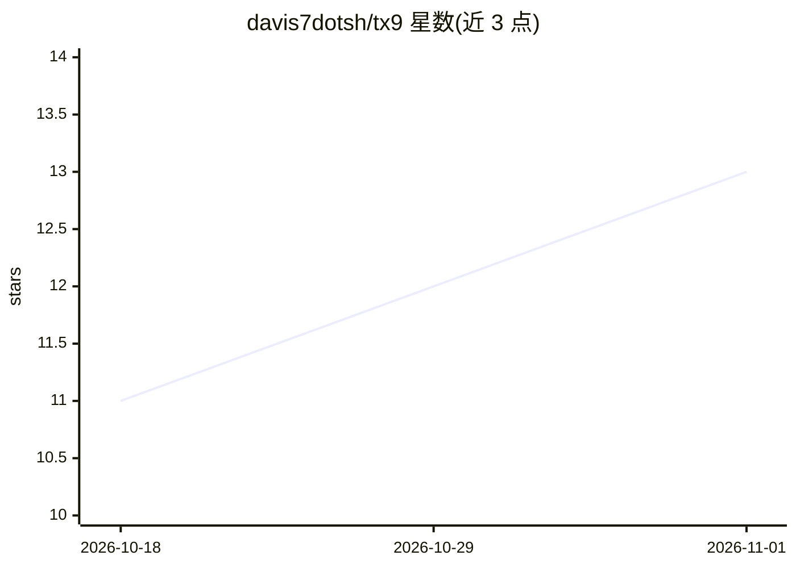

# davis7dotsh/tx9

⭐ 13 · Go · 推送 2026-10-13 · [GitHub](https://github.com/davis7dotsh/tx9) · [官网](https://tx9.col-agents.com) · 个人维护

**在 Docker 中隔离运行编码 agent（Claude Code 等）的盒子管理 CLI**

Go 编写的 CLI 工具 tx9，用于创建、管理由双容器组成的可移植 agent 盒子：每盒含一个自由行动的 agent 容器（Claude Code、Codex、Hermes）和一个隔离的 Executor 容器，运行于私有网络；agent 状态存于命名卷，可生成加密校验的备份归档迁移。提供主机侧 CLI（tx9）与盒内 CLI（hb）完成生命周期、日志、资源限制、主机挂载与网关管理；盒内可定义可移植自定义服务。README 明示安全限制：agent 会获得 Executor 管理员令牌，容器隔离不保证凭据机密性。面向自托管运行编码 agent 的开发者。

## 筛选速览

| 维度 | 判定 | 备注 |
|---|---|---|
| AI 角色 | `ai-ecosystem` | LLM/agent 周边工具 |
| 许可风险 | `none` | — |
| 部署形态 | `self-host` | docker 或自建部署 |
| 模型依赖 | — | README 未给出锁定关系 |
| 硬件要求 | — | 无带数字的原话,不猜 |
| 安装摩擦 | `low` | 无编译、无系统依赖或容器化 |
| 成熟度 | — | 结构信号不足 |

## 能力要点

- 双容器模型：agent 容器 + 隔离 Executor 容器，私有网络
- agent 卷可导出为 GPG AES-256 加密并逐成员校验的备份归档
- tx9/hb 双 CLI：资源限额、结构化日志查询与脱敏、自定义服务监督
- 支持 Claude Code、Codex、Hermes，随 Docker 镜像层升级

## 适用场景

- 在隔离 Docker 环境中长期运行编码 agent 并保留可迁移状态
- 对多个 agent 盒子统一查看状态、资源限额与日志
- 跨主机搬迁 agent 工作区（加密备份/恢复）

## 场景标签

 · 领域:开发工具/Agent 基础设施

## 证据(README 行号)

> L3: Isolated, portable agent boxes with **Claude Code, Codex, Hermes, and
> L4: Executor**, running on Docker. Each box is a pair of containers on a private
> L5: network — a free-rein agent container and an isolated Executor container —

## 星数曲线

2026-10-18 11 → 2026-11-01 13（+2）

---
*卡片 v1 · prompt 1.4 · 生成 2026-10-31 · 置信度 high · 依据 README sha `ec0083ef32d0` · [字段定义](../../DATASET.md)*
