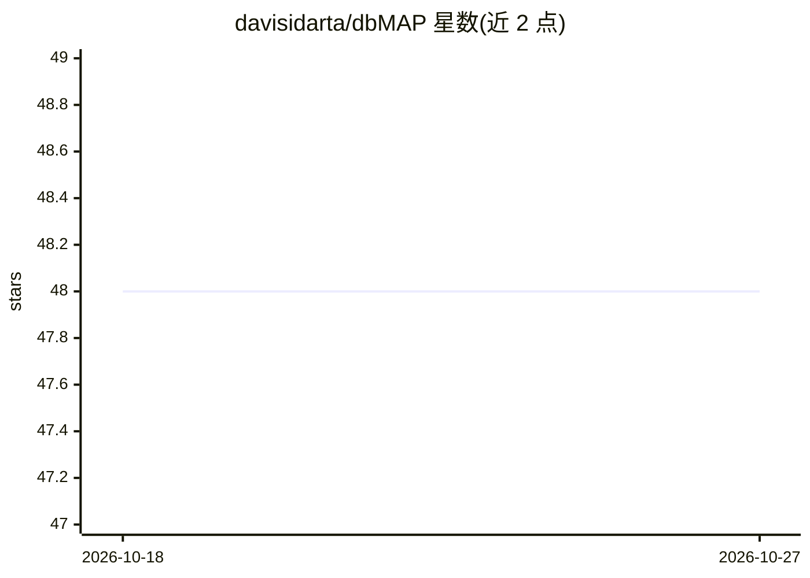

# davisidarta/dbMAP

⭐ 48 · Python · GPL-2.0 · 推送 2026-04-07 · [GitHub](https://github.com/davisidarta/dbMAP) · [官网](https://topometry.readthedocs.io/) · 个人维护

**基于扩散流形逼近的高维数据降维与可视化框架，面向单细胞组学**

dbMAP 是一个机器学习框架，通过快速近似 Laplace-Beltrami 算子学习自适应扩散基，估计数据本征维度并进行多尺度扩散映射降维，再以 UMAP、PaCMAP、pyMDE、fa2 等布局方法可视化扩散图。输入支持 numpy 数组、pandas DataFrame 与稀疏矩阵，内置 nmslib/annoy 近似最近邻封装。面向单细胞 RNA 测序等高维非线性数据分析，提供 Scanpy（Python）与 Seurat/reticulate（R）使用脚本。注意：项目已声明停止维护，推荐其后续项目 TopoMetry。安装需先具备 cmake 与 scikit-build。

## 筛选速览

| 维度 | 判定 | 备注 |
|---|---|---|
| AI 角色 | `ai-native` | 本体是模型或模型工具 |
| 许可风险 | `viral` | GPL-2.0 |
| 部署形态 | `library` | 以包/库形式分发 |
| 模型依赖 | — | README 未给出锁定关系 |
| 硬件要求 | — | 无带数字的原话,不猜 |
| 安装摩擦 | `medium` | 含编译或系统依赖之一 |
| 成熟度 | — | 结构信号不足 |

## 能力要点

- Laplace-Beltrami 算子的可扩展近似与本征维度估计
- 多尺度扩散映射降维，可扩展至约 10e9 样本量级
- 适配的 UMAP/PaCUMAP 及 fa2 图布局可视化
- nmslib/annoy 近似最近邻搜索的 sklearn 风格封装

## 适用场景

- 单细胞 RNA 测序数据的降维、聚类与可视化
- 非线性高维数据的本征维度估计与流形分析
- 配合 Scanpy 或 Seurat 做单细胞分析流程

## 场景标签

 · 领域:生物信息学/机器学习

## 证据(README 行号)

> L9: Diffusion-based Manifold Approximaiton and Projection (dbMAP) is a fast, accurate and modularized machine-learning f
> L15: dbMAP explores the use of the Laplace-Beltrami Operator (LBO) to geometrically describe heterogeneity within a give
> L11: data, such as from single-cell RNA sequencing assays. dbMAP was originally designed for the analysis

## 星数曲线

2026-10-18 48 → 2026-10-27 48（+0）

---
*卡片 v1 · prompt 1.4 · 生成 2026-10-25 · 置信度 high · 依据 README sha `f63b526546d8` · [字段定义](../../DATASET.md)*
