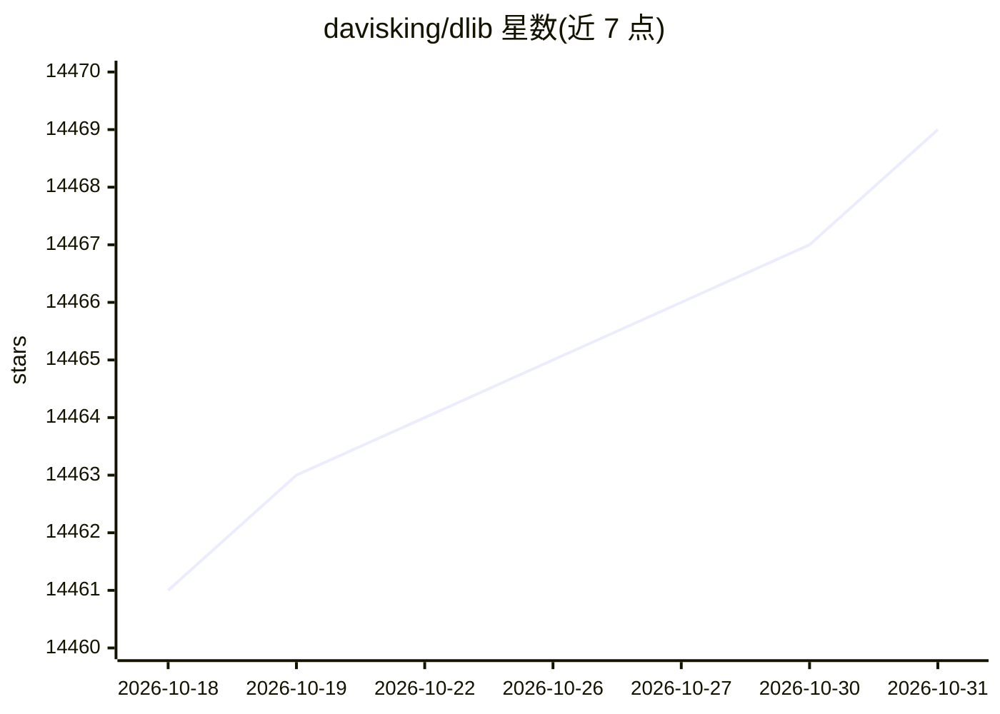

# davisking/dlib

⭐ 14,469 · C++ · BSL-1.0 · 推送 2026-10-21 · [GitHub](https://github.com/davisking/dlib) · [官网](http://dlib.net) · 个人维护

**C++ 机器学习与数据分析算法工具库**

一个 C++ 工具包，包含机器学习算法与用于构建复杂软件的工具，同时提供 Python API。README 给出三条使用路径：编译 examples 目录的 C++ 示例程序（需 C++17 编译器与 CMake）、通过 vcpkg 安装 C++ 库、以及从 PyPI 或 GitHub 源码安装 Python API。构建时可开启 AVX 指令加速，支持通过 setup.py 参数或 DLIB_* 环境变量调整构建选项。采用 Boost 软件许可证，允许闭源商业使用。

## 筛选速览

| 维度 | 判定 | 备注 |
|---|---|---|
| AI 角色 | `ai-ecosystem` | LLM/agent 周边工具 |
| 许可风险 | `permissive` | BSL-1.0 |
| 部署形态 | `library` | 以包/库形式分发 |
| 模型依赖 | — | README 未给出锁定关系 |
| 硬件要求 | — | 无带数字的原话,不猜 |
| 安装摩擦 | `medium` | 含编译或系统依赖之一 |
| 成熟度 | — | 结构信号不足 |

## 动量与使用信号

- 维护:`active` — 距上次 push 13.5 天,年发版 1,194 位贡献者
- 涨星:近 1 天 **+0**(自 20261016 起算)
- 安装:pypi 包 `dlib` 月下载 171,622
- 平台:WINDOWS · 协议:—

## 能力要点

- C++ 机器学习算法工具包，附 Python API
- vcpkg 单命令安装 C++ 库并集成 CMake
- AVX 指令加速选项与 DLIB_* 环境变量构建配置
- Boost 许可证，允许闭源商业使用

## 适用场景

- 在 C++ 项目中集成机器学习算法
- 在 Python 中使用 dlib 的机器学习功能
- 通过 vcpkg 管理依赖的 C++ 工程引入该库

## 场景标签

`目标检测` · 领域:感知与多模态

## 证据(README 行号)

> L3: Dlib is a modern C++ toolkit containing machine learning algorithms and tools for creating complex software in C++ t
> L7: You need a C++17 compiler and CMake. Go into the examples folder and type:
> L38: Either fetch the latest stable release of dlib from PyPi and install that:

## 星数曲线

2026-10-18 14,461 → 2026-10-31 14,469（+8）

---
*卡片 v1 · prompt 1.4 · 生成 2026-10-18 · 置信度 high · 依据 README sha `47d73a7eefa7` · [字段定义](../../DATASET.md)*
