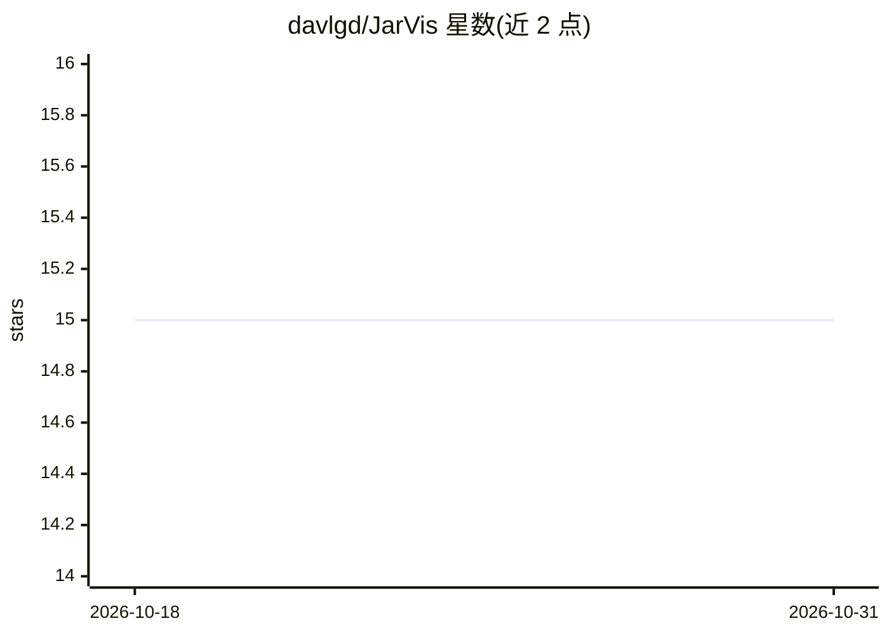

# davlgd/JarVis

⭐ 15 · V · MIT · 推送 2026-10-04 · [GitHub](https://github.com/davlgd/JarVis) · 个人维护

**多平台 CLI 助手：通过任意 OpenAI 兼容 API 对话问答**

用 V 语言编写的命令行 AI 助手，面向在终端工作的个人用户：连接任意 OpenAI 兼容 API 服务器（示例配置指向 localhost:11434，如 Ollama），支持列出/切换服务端模型、单次提问与交互模式。通过 TOML 文件配置主机、端口、模型、TLS 证书等，支持推理模型参数（reasoning_effort、max_tokens）。构建需 V 工具链（tools/build 脚本），也可作为 V 模块（jarvis.api）在其他程序中调用流式补全接口。MIT 许可。

## 筛选速览

| 维度 | 判定 | 备注 |
|---|---|---|
| AI 角色 | `ai-ecosystem` | LLM/agent 周边工具 |
| 许可风险 | `permissive` | MIT |
| 部署形态 | `None` |  |
| 模型依赖 | local-ok | 支持本地模型 |
| 硬件要求 | — | 无带数字的原话,不猜 |
| 安装摩擦 | `low` | 无编译、无系统依赖或容器化 |
| 成熟度 | — | 结构信号不足 |

## 能力要点

- 连接任意 OpenAI 兼容 API，支持模型列表与切换
- 交互模式与单次提问两种使用方式
- reasoning_effort / max_tokens 等推理模型参数与 TLS 证书配置
- 可作为 V 模块复用（jarvis.api、jarvis.config）

## 适用场景

- 在终端直接向本地或远程 LLM 提问
- 在多个服务端模型之间快速切换使用
- 在 V 程序中集成 OpenAI 兼容 API 调用

## 场景标签

`AI 助手` · 领域:对话与助手

## 证据(README 行号)

> L3: JarVis is a CLI assistant that uses any OpenAI compatible API to help you with your daily tasks. You can list availa
> L29: Reasoning models think before answering, and may reach their length limit before the answer. Optionally, set `reaso

## 星数曲线

2026-10-18 15 → 2026-10-31 15（+0）

---
*卡片 v1 · prompt 1.4 · 生成 2026-10-30 · 置信度 high · 依据 README sha `2edc17c9accb` · [字段定义](../../DATASET.md)*
