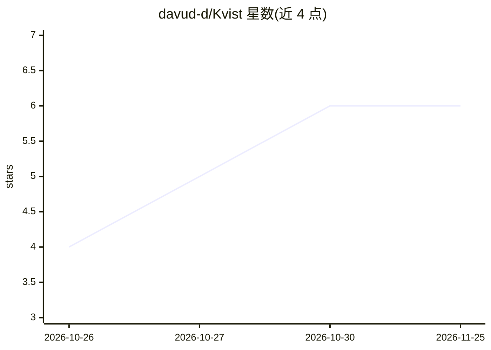

# davud-d/Kvist

⭐ 6 · Python · MIT · 推送 2026-11-21 · [GitHub](https://github.com/davud-d/Kvist) · 个人维护

**在终端与编辑器中运行的沙箱化编码代理**

Kvist 是运行于终端并集成 VS Code、JetBrains、Zed 等编辑器的编码代理：读取项目代码、编辑文件、运行命令并核验结果，文件写入与高风险命令经审批步骤，所有改动记入日志可回滚。通过 AnyModel 或任一 OpenAI 兼容端点接入约 40 个服务商，可用 `/provider` 切换；Linux 上命令默认在无网络的 Bubblewrap 沙箱运行；会话可命名保存并从检查点恢复。当前为 beta 版（0.1.0b1），README 声明其为监督型工具而非安全边界。

## 筛选速览

| 维度 | 判定 | 备注 |
|---|---|---|
| AI 角色 | `ai-native` | 本体是模型或模型工具 |
| 许可风险 | `permissive` | MIT |
| 部署形态 | `desktop` | 安装包/桌面程序 |
| 模型依赖 | locked-api |  |
| 硬件要求 | — | 无带数字的原话,不猜 |
| 安装摩擦 | `low` | 无编译、无系统依赖或容器化 |
| 成熟度 | `idea` | |

## 能力要点

- 同一代理可在终端、桌面应用、浏览器、VS Code、JetBrains 与 Zed 中运行
- 文件写入与 shell 命令统一经审批，Linux 上默认无网络 Bubblewrap 沙箱
- 改动日志化，`/changes` 列出、`/revert` 回滚，会话可从崩溃点恢复
- 无工具调用能力的模型回退到纯 JSON 协议，低价模型可用

## 适用场景

- 在终端中描述任务让代理读代码、改文件、跑测试
- 自行选择模型服务商并随时切换
- 需要每步审批与可回滚改动的受监督编码流程
- 在 VS Code 或 JetBrains 中通过聊天面板启动代理并生成提交信息

## 场景标签

`编码 Agent` · 领域:编码与开发

## 证据(README 行号)

> L18: Kvist is a coding agent that runs in your terminal and works inside one
> L28: - **Any provider.** One key from OpenAI, Anthropic, DeepSeek, OpenRouter, a
> L46:  browser (`kvist-web`), VS Code, JetBrains IDEs and Zed.

## 星数曲线

2026-10-26 4 → 2026-11-25 6（+2）

---
*卡片 v1 · prompt 1.4 · 生成 2026-11-20 · 置信度 mid · 依据 README sha `3a4516331fa2` · [字段定义](../../DATASET.md)*
