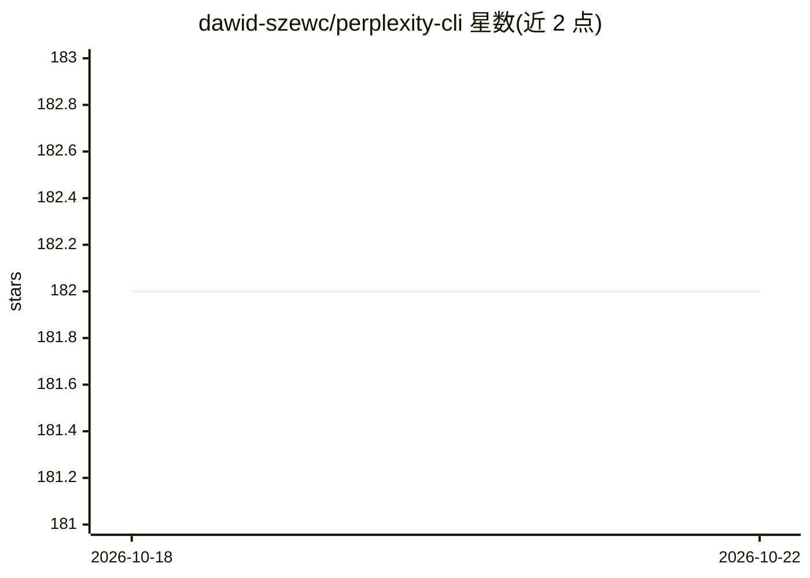

# dawid-szewc/perplexity-cli

⭐ 182 · Python · MIT · 推送 2025-11-07 · [GitHub](https://github.com/dawid-szewc/perplexity-cli) · 个人维护

**在终端调用 Perplexity API 问答的 Python 命令行客户端**

单文件 Python 脚本封装 Perplexity API：用户在终端输入问题，获取回答及可选的引用与 token 用量统计。支持 sonar、sonar-pro、sonar-reasoning、sonar-reasoning-pro 四个模型，API key 通过环境变量或命令行参数传入，输出支持彩色与 Glow 格式。无需安装，可直接 curl 下载脚本到本地 PATH 运行；依赖 Python 3.6+ 与 requests 库，需自备 Perplexity API key。

## 筛选速览

| 维度 | 判定 | 备注 |
|---|---|---|
| AI 角色 | `ai-ecosystem` | LLM/agent 周边工具 |
| 许可风险 | `permissive` | MIT |
| 部署形态 | `None` |  |
| 模型依赖 | — | README 未给出锁定关系 |
| 硬件要求 | — | 无带数字的原话,不猜 |
| 安装摩擦 | `low` | 无编译、无系统依赖或容器化 |
| 成熟度 | — | 结构信号不足 |

## 能力要点

- 命令行直接向 Perplexity API 提问并获取回答
- 可选显示引用与 token 用量统计
- 支持 4 个 sonar 系列模型切换
- API key 支持环境变量或命令行参数两种传入方式

## 适用场景

- 在终端快速向 Perplexity 提问获取带引用的回答
- 脚本中调用 Perplexity API 并查看 token 消耗
- 偏好命令行而非网页界面的 Perplexity 用户日常查询

## 场景标签

`AI 助手` · 领域:对话与助手

## 证据(README 行号)

> L3: Perplexity CLI is a simple and convenient command-line client for the Perplexity API, allowing users to quickly ask 
> L6: - Easy querying of the Perplexity API
> L7: - Support for various language models

## 星数曲线

2026-10-18 182 → 2026-10-22 182（+0）

---
*卡片 v1 · prompt 1.4 · 生成 2026-10-22 · 置信度 high · 依据 README sha `8d3b1bfed583` · [字段定义](../../DATASET.md)*
