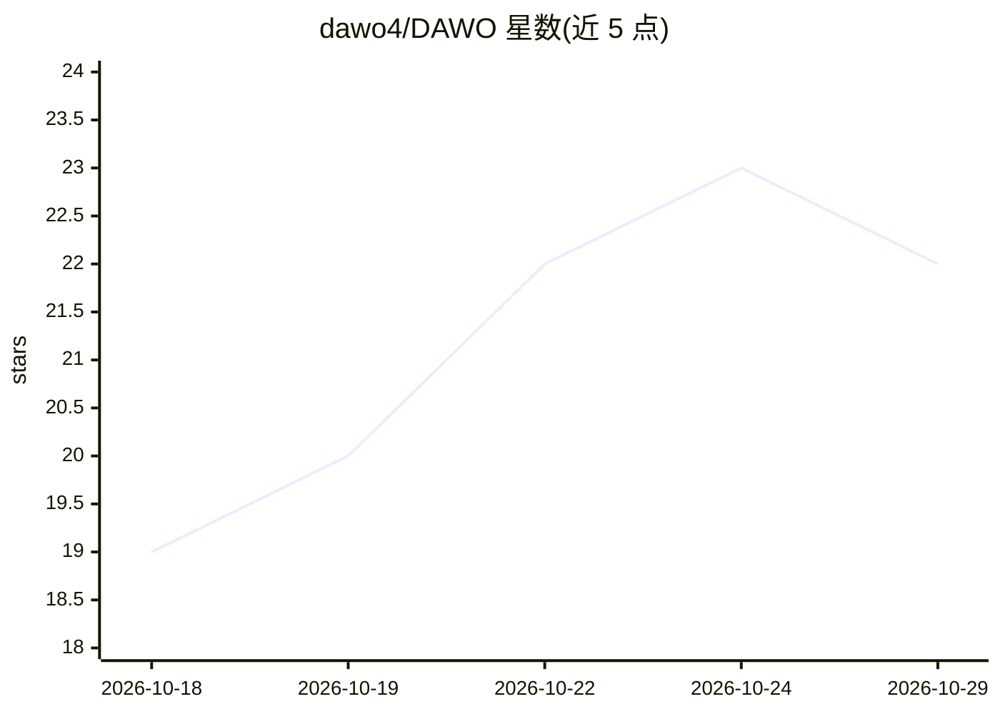

# dawo4/DAWO

⭐ 22 · Vue · 推送 2026-10-18 · [GitHub](https://github.com/dawo4/DAWO) · [官网](https://github.com/dawo4/DAWO/releases) · 个人维护 · 中文 README

**面向长篇网文作者的本地优先 AI 写作桌面软件**

Electron + Vue 3 桌面应用，供十万字以上长篇网文创作：九大结构化资料板块（时间线/角色关系/伏笔/境界体系等）、十五个内置智能体、提案制写入（AI 修改先出差异预览卡）、从一句话到逐章生文的工作流，以及本地零 token 的六维去 AI 味打分器。接入任意 OpenAI 兼容服务商（含 Ollama 本地模型），Key 只存本机，书稿为本地 Markdown/JSON。Windows 提供安装包；暂未开源授权，发布前不可二次分发。

## 筛选速览

| 维度 | 判定 | 备注 |
|---|---|---|
| AI 角色 | `ai-native` | 本体是模型或模型工具 |
| 许可风险 | `none` | — |
| 部署形态 | `desktop` | 安装包/桌面程序 |
| 模型依赖 | local-ok | 支持本地模型 |
| 硬件要求 | — | 无带数字的原话,不猜 |
| 安装摩擦 | `low` | 无编译、无系统依赖或容器化 |
| 成熟度 | — | 结构信号不足 |

## 能力要点

- 十五个内置智能体 + 提案制写入与冲突检测
- 逐章生文工作流：保守裁剪注入、伏笔硬约束、最多 2000 章
- 去 AI 味：本地六维打分器零 token，22 种 AI 指纹三级诊断与 L1-L4 改写
- 九条任务通道可为不同任务分别配置服务商与模型

## 适用场景

- 我写长篇网文时用 AI 逐章生成正文并管理设定/伏笔/角色资料
- 接入自己选的大模型服务商做大纲、正文、润色分工
- 对成稿做去 AI 味检测与分级改写

## 场景标签

`AI 写作` · 领域:内容生成

## 证据(README 行号)

> L3: 一款免费、本地优先的长篇网文写作桌面软件。整合工作流式逐章生成、九大结构化资料板块、可审阅的智能体系统与去 AI 味工具链，面向十万字以上的长篇创作。
> L12: 2. 打开「设置 → AI 服务」，添加任意 OpenAI 兼容服务商并填入 API Key（Key 只存本机 `%APPDATA%\inkdesk`，不经过任何中间服务器）
> L117: **支持哪些模型？** 任意 OpenAI 兼容接口：DeepSeek、Kimi、智谱、通义、小米 MiMo、OpenAI，以及 Ollama 本地模型。逐章正文建议配性价比模型。

## 星数曲线

2026-10-18 19 → 2026-10-29 22（+3）

---
*卡片 v1 · prompt 1.4 · 生成 2026-10-27 · 置信度 mid · 依据 README sha `1305e65c2ef1` · [字段定义](../../DATASET.md)*
