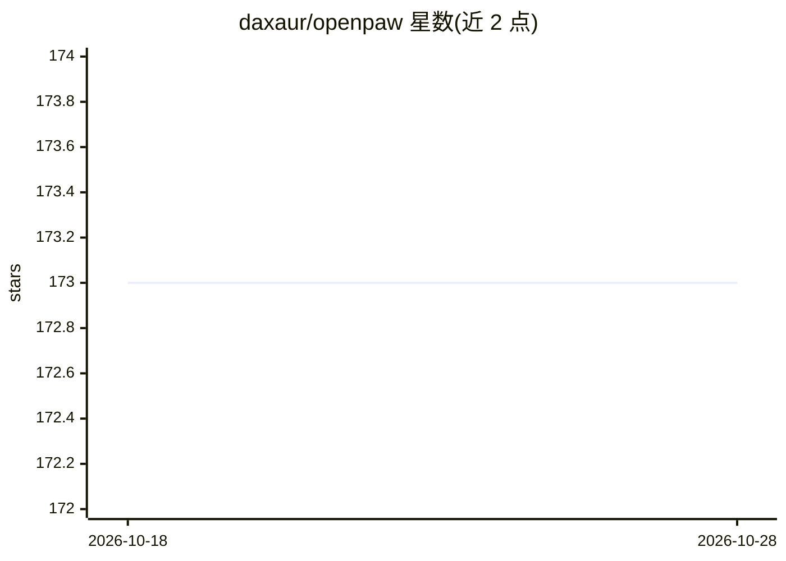

# daxaur/openpaw

⭐ 173 · TypeScript · MIT · 推送 2026-05-23 · [GitHub](https://github.com/daxaur/openpaw) · [官网](https://www.npmjs.com/package/pawmode) · 个人维护

**将 Claude Code 配置为个人助理的安装向导（38 个技能）**

面向 macOS 用户的 Claude Code 配置工具：运行 npx pawmode 向导后安装 38 个技能（邮件、日历、Spotify、智能家居、Slack、GitHub、Obsidian 等 8 类），配置各技能所需 CLI 工具与认证，为 Claude 设定身份与跨会话记忆，配置权限与安全 hooks，并内置 Telegram 桥接、本地看板任务面板、带成本上限的定时任务。无守护进程、无云端，全部通过已有的 Claude Code 订阅本地运行。另提供从 Hermes/OpenClaw/Copilot 迁移记忆、自学习与 token 压缩等可选功能。

## 筛选速览

| 维度 | 判定 | 备注 |
|---|---|---|
| AI 角色 | `ai-ecosystem` | LLM/agent 周边工具 |
| 许可风险 | `permissive` | MIT |
| 部署形态 | `library` | 以包/库形式分发 |
| 模型依赖 | — | README 未给出锁定关系 |
| 硬件要求 | — | 无带数字的原话,不猜 |
| 安装摩擦 | `medium` | 含编译或系统依赖之一 |
| 成熟度 | — | 结构信号不足 |

## 能力要点

- 一条命令安装 38 个技能并配置 CLI 工具与认证
- Telegram 桥接与本地看板任务面板
- 带单次/每日成本上限的定时任务
- 从 Hermes/OpenClaw/Copilot/Claude Code 导入既有记忆

## 适用场景

- 把 Claude Code 扩展为控制邮件、音乐、灯光、日历的个人助理
- 通过 Telegram 在手机上与 Claude 对话
- 为 Claude Code 按需挑选技能组合（essentials/developer 等预设）

## 场景标签

`AI 助手` `工作流自动化` · 领域:效率与自动化

## 证据(README 行号)

> L13: Claude Code is powerful, but out of the box it only knows how to code. OpenPaw turns it into a full personal assist
> L17: - **Installs 38 skills** across email, calendar, Spotify, smart home, Slack, GitHub, Obsidian, and more
> L39: **No daemon, no cloud, no subscriptions.** OpenPaw runs once, writes config, and gets out of the way. Everything ru

## 星数曲线

2026-10-18 173 → 2026-10-28 173（+0）

---
*卡片 v1 · prompt 1.4 · 生成 2026-10-22 · 置信度 high · 依据 README sha `ae214a238d6e` · [字段定义](../../DATASET.md)*
