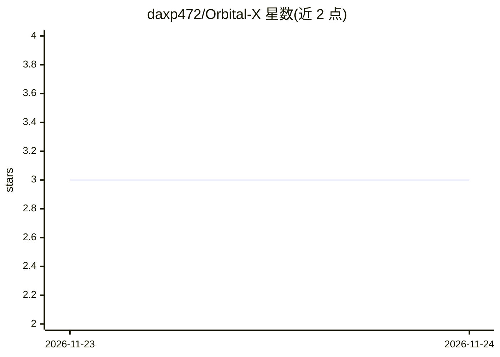

# daxp472/Orbital-X

⭐ 3 · JavaScript · MIT · 推送 2026-11-22 · [GitHub](https://github.com/daxp472/Orbital-X) · [官网](https://daxp472.github.io/Orbital-X/) · 个人维护

**面向软件工程师的本地模型 AI 编码桌面 IDE**

基于 Tauri 2 + Rust 的桌面编码 IDE，集成可调用工具的自主 AI 编码代理，通过 Ollama 运行本地模型实现离线推理。功能包括逐文件接受/拒绝与回滚、持久项目记忆管理、最多 3 个专属 AI 终端、内联代码补全（独立轻量 coder 模型）、截图多模态输入，以及 Rust 内强制的三档安全策略（Agent Pro/Dev/User）。Windows/macOS/Linux 提供安装包，也可从源码构建。

## 筛选速览

| 维度 | 判定 | 备注 |
|---|---|---|
| AI 角色 | `ai-native` | 本体是模型或模型工具 |
| 许可风险 | `permissive` | MIT |
| 部署形态 | `desktop` | 安装包/桌面程序 |
| 模型依赖 | local-ok | 支持本地模型 |
| 硬件要求 | — | 无带数字的原话,不猜 |
| 安装摩擦 | `low` | 无编译、无系统依赖或容器化 |
| 成熟度 | — | 结构信号不足 |

## 能力要点

- 通过 Ollama 100% 本地推理，流式输出
- 权限门控工具矩阵与三档安全策略（Rust 内强制）
- 持久项目记忆（1-5 星评级、分类过滤）与 VFS 快照回滚
- tree-sitter 语义代码图与两阶段提交的虚拟文件系统

## 适用场景

- 在离线或隐私受限环境中用本地模型进行 AI 辅助编码
- 需要按文件粒度审查并回滚 AI 代码修改的开发流程
- 让代理执行多步工程任务并实时监控其终端命令

## 场景标签

`编码 Agent` · 领域:编码与开发

## 证据(README 行号)

> L10: **A high-performance, memory-conscious, autonomous AI coding IDE powered by your own local models.**
> L17: **Orbital X** combines a native desktop code editor with a deeply integrated, tool-using autonomous AI agent — engi
> L105: Security policies are enforced inside Rust (`PolicyEngine`) — frontend actions cannot bypass them:

## 星数曲线

2026-11-23 3 → 2026-11-24 3（+0）

---
*卡片 v1 · prompt 1.4 · 生成 2026-11-23 · 置信度 high · 依据 README sha `44f3b5c8b884` · [字段定义](../../DATASET.md)*
