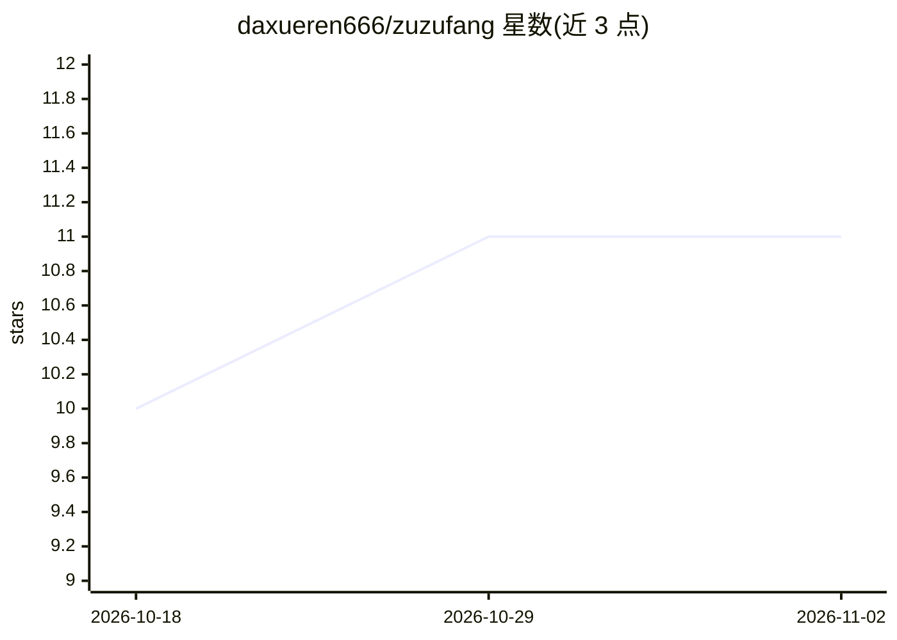

# daxueren666/zuzufang

⭐ 11 · Python · NOASSERTION · 推送 2026-08-19 · [GitHub](https://github.com/daxueren666/zuzufang) · 个人维护 · 中文 README

**国内租房咨询的 Agent Skill：采集多平台口碑生成尽调报告**

面向 Claude Code、Codex CLI 等 agent 的租房技能（rent-assist）：用户以自然语言提出租房问题（小区尽调、中介口碑核验、选址对比、转租房源查找），技能通过 Agent-Reach 采集小红书、豆瓣、抖音、网页等公开口碑与房源帖，老帖按发布时间降权，输出带八维评分、证据回链与地图的 HTML 报告，落在本地 ~/.rent-assist/。需 Python 3.10+ 与终端可执行命令的 AI 助手；地图依赖高德 key（可选，缺失则降级纯文字）。数据与登录态全存本机；许可为 PolyForm Noncommercial，仅限个人非商业使用。

## 筛选速览

| 维度 | 判定 | 备注 |
|---|---|---|
| AI 角色 | `ai-native` | 本体是模型或模型工具 |
| 许可风险 | `none` | NOASSERTION |
| 部署形态 | `library` | 以包/库形式分发 |
| 模型依赖 | — | README 未给出锁定关系 |
| 硬件要求 | — | 无带数字的原话,不猜 |
| 安装摩擦 | `low` | 无编译、无系统依赖或容器化 |
| 成熟度 | — | 结构信号不足 |

## 能力要点

- 四平台公开口碑采集（小红书/豆瓣/抖音/网页），抖音口播自动转写进分析
- 报告每条结论可点回原帖，老帖按时间自动降权
- 选址对比输出 3-5 个候选片区 + 地图（高德）
- 同一小区 7 天内复用上次数据不重采

## 适用场景

- 租房前对小区做口碑尽调和风险核查
- 对比通勤、价格、口碑选择居住片区
- 查找近 7 天个人转租房源并获防骗清单

## 场景标签

`网页抓取` · 领域:效率与自动化

## 证据(README 行号)

> L17: |"天通苑怎么样？"|尽调报告：八维评分、风险发现、房源价格、好评精选，每条结论都能点回原帖|
> L25: 尽调/口碑/选址类问题默认采集小红书、豆瓣、网页、抖音四平台（选址以小红书+网页+抖音为主，豆瓣对小片区命中率低不默认参与；找房以豆瓣+小红书为主——均可按需加平台）。抖音视频默认自动转写口播内容进分析。
> L33: 时长看选的量级：轻量约 20 分钟、标准约 1 小时、深度约 2 小时（页面/会话里三档可选，也能自定义条数）。完成后出一份 HTML 报告，落在 `~/.rent-assist/data/reports/`（手机直接看），附一句

## 星数曲线

2026-10-18 10 → 2026-11-02 11（+1）

---
*卡片 v1 · prompt 1.4 · 生成 2026-11-02 · 置信度 mid · 依据 README sha `7cdf90855695` · [字段定义](../../DATASET.md)*
