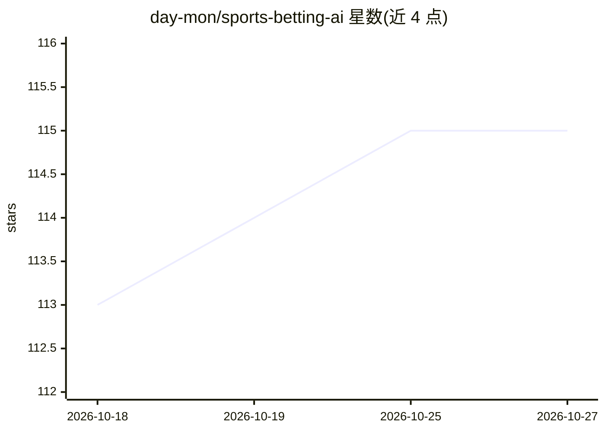

# day-mon/sports-betting-ai

⭐ 115 · Rust · 推送 2026-10-26 · [GitHub](https://github.com/day-mon/sports-betting-ai) · [官网](https://accuribet.win) · 个人维护

**用神经网络预测 NBA 比赛胜负的体育下注网站**

Accuribet 是一个体育赛事预测网站，使用深度学习神经网络基于 42-48 个数据点预测比赛结果，测试阶段报告约 60% 准确率（README 自述，未附验证）。项目为匹兹堡大学约翰斯敦分校 CS 1783 人工智能课程期末作品。技术栈为 Rust、Postgres、SolidJS、TailwindCSS、TensorFlow、Redis，README 提供“View Live Website”在线访问入口，未给出本地安装运行步骤。

## 筛选速览

| 维度 | 判定 | 备注 |
|---|---|---|
| AI 角色 | `ai-native` | 本体是模型或模型工具 |
| 许可风险 | `none` | — |
| 部署形态 | `None` |  |
| 模型依赖 | — | README 未给出锁定关系 |
| 硬件要求 | — | 无带数字的原话,不猜 |
| 安装摩擦 | `low` | 无编译、无系统依赖或容器化 |
| 成熟度 | — | 结构信号不足 |

## 能力要点

- 深度学习神经网络预测比赛胜负
- 使用 42-48 个数据点作为预测输入
- 全栈实现：Rust 后端 + SolidJS 前端 + Postgres/Redis

## 适用场景

- 查看 NBA 比赛胜负的机器学习预测结果
- 作为课程级深度学习预测项目的参考实现

## 场景标签

 · 领域:体育预测/博彩

## 证据(README 行号)

> L7:  A new way to bet on sports. Accuribet utilizes machine learning to predict the outcome of sporting events. We use 4
> L16: This project was a final project for CS 1783 (Artificial Intelligence) at the University of Pittsburgh at Johnstown

## 星数曲线

2026-10-18 113 → 2026-10-27 115（+2）

---
*卡片 v1 · prompt 1.4 · 生成 2026-10-23 · 置信度 mid · 依据 README sha `1d3029e2248d` · [字段定义](../../DATASET.md)*
