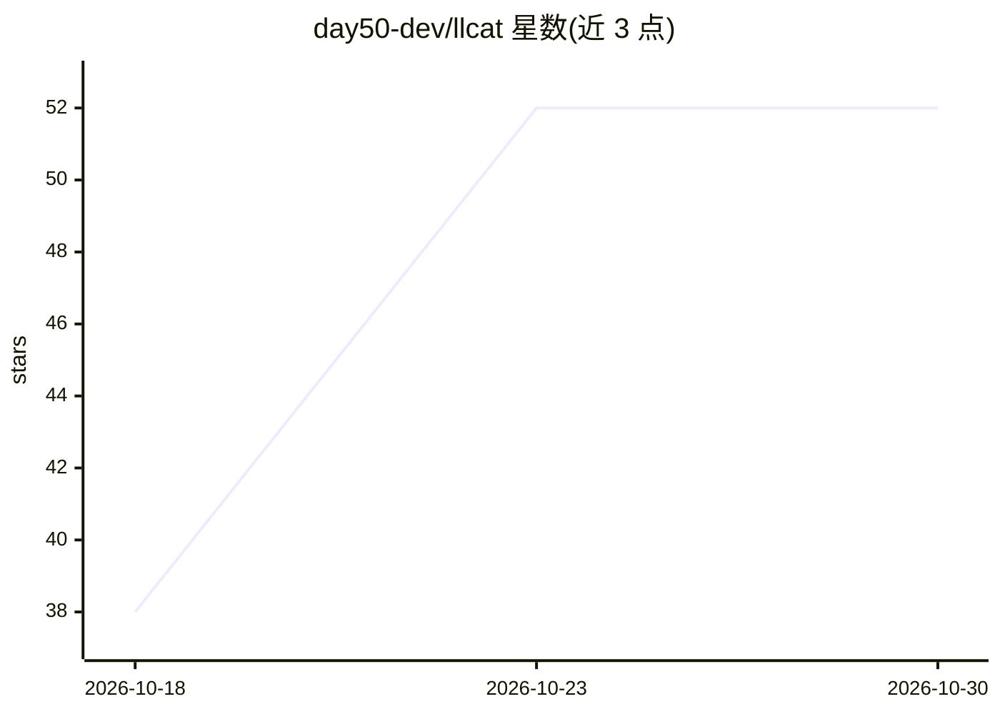

# day50-dev/llcat

⭐ 52 · Python · MIT · 推送 2026-10-27 · [GitHub](https://github.com/day50-dev/llcat) · 组织维护

**面向 LLM 端点的无状态 CLI 调用器，用于测试/脚本化推理请求**

通用 CLI 工具，以 OpenAI 兼容 /chat/completions 与 Anthropic /v1/messages 两种协议调用推理端点，支持 Ollama、OpenRouter、SGLang、vLLM、LocalAI、llama.cpp 等。所有参数（服务器、密钥、模型、对话）均以命令行显式指定，无配置文件与隐式状态；支持 @file:line 与 jq 语法引用参数、--save/--load 调用存档、协议自动检测、schema 结构化输出、工具调用与 MCP（附 22 行 Bash 脚本 mcpcat）。可列出远端模型、循环多密钥/多模型执行评测，面向做 LLM 基础设施调试与脚本编排的开发者。通过 uvx 直接运行。

## 筛选速览

| 维度 | 判定 | 备注 |
|---|---|---|
| AI 角色 | `ai-ecosystem` | LLM/agent 周边工具 |
| 许可风险 | `permissive` | MIT |
| 部署形态 | `None` |  |
| 模型依赖 | local-ok | 支持本地模型 |
| 硬件要求 | — | 无带数字的原话,不猜 |
| 安装摩擦 | `low` | 无编译、无系统依赖或容器化 |
| 成熟度 | — | 结构信号不足 |

## 能力要点

- OpenAI 兼容与 Anthropic Messages 双协议，协议自动检测，对话可跨协议重放
- 服务器/密钥/模型/对话全部显式命令行指定，支持 @file 与 jq 语法取参
- --save/--load 调用存档与 --curlify 导出为 curl
- 附带 mcpcat（22 行 Bash）操作 MCP STDIO 传输

## 适用场景

- 一条命令验证推理端点是否可用并列出其模型
- 跨多密钥、多模型、多服务器并行跑查询或评测
- 作为脚本积木搭建对话循环、结构化输出或 agentic 编码流程

## 场景标签

 · 领域:LLM 基础设施/开发工具

## 证据(README 行号)

> L12: **llcat** is a solution to these problems: a general-purpose CLI-based OpenAI-compatible `/chat/completions` and An
> L33: Think of `llcat` like cURL or cat for LLMs: a stateless, transparent, explicit, low-level, composable tool for scri

## 星数曲线

2026-10-18 38 → 2026-10-30 52（+14）

---
*卡片 v1 · prompt 1.4 · 生成 2026-10-24 · 置信度 high · 依据 README sha `7ef426cdd6ab` · [字段定义](../../DATASET.md)*
