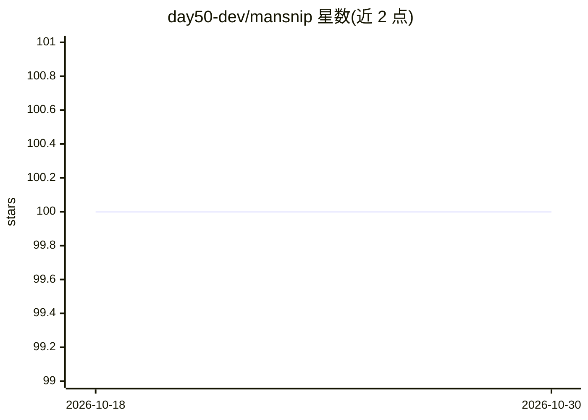

# day50-dev/mansnip

⭐ 100 · Python · MIT · 推送 2026-10-23 · [GitHub](https://github.com/day50-dev/mansnip) · [官网](https://day50.dev) · 个人维护

**把 manpage 相关片段注入 LLM 上下文的 CLI/MCP 工具**

DAY50 开源套件中的命令行工具：读取本地 manpage，按查询词输出自包含的可浏览片段，供终端查阅或以 --llm 模式注入提示词上下文，README 展示对比整页 man 的 token 消耗约减少 98%。另附 mcp-server.py 提供 MCP 服务器形式，可被模型调用以获取本机软件文档。通过 pip/pipx/uv 安装，适用于任何 manpage。

## 筛选速览

| 维度 | 判定 | 备注 |
|---|---|---|
| AI 角色 | `ai-ecosystem` | LLM/agent 周边工具 |
| 许可风险 | `permissive` | MIT |
| 部署形态 | `library` | 以包/库形式分发 |
| 模型依赖 | — | README 未给出锁定关系 |
| 硬件要求 | — | 无带数字的原话,不猜 |
| 安装摩擦 | `low` | 无编译、无系统依赖或容器化 |
| 成熟度 | — | 结构信号不足 |

## 能力要点

- 按查询从 manpage 提取相关片段注入上下文
- README 给出整页 man 与 mansnip 的 token 消耗对比（98% 减少）
- 附带可用的 MCP 服务器（mcp-server.py）
- uvx mansnip 直接运行，支持 --llm 输出模式

## 适用场景

- 让 LLM 引用本机实际安装软件的 manpage 而非联网文档
- 减少向上下文注入无关文档的 token 开销
- 终端中快速检索 manpage 片段替代翻页搜索

## 场景标签

 · 领域:开发者工具/LLM 上下文管理

## 证据(README 行号)

> L9: **Mansnip**, part of the DAY50 suite of open-source tools for AI workflows, solves the problem of irrelevant documen
> L33: There's also a ready-to-go MCP server for it in `mcp-server.py`.

## 星数曲线

2026-10-18 100 → 2026-10-30 100（+0）

---
*卡片 v1 · prompt 1.4 · 生成 2026-10-23 · 置信度 high · 依据 README sha `dfb32f57a51f` · [字段定义](../../DATASET.md)*
