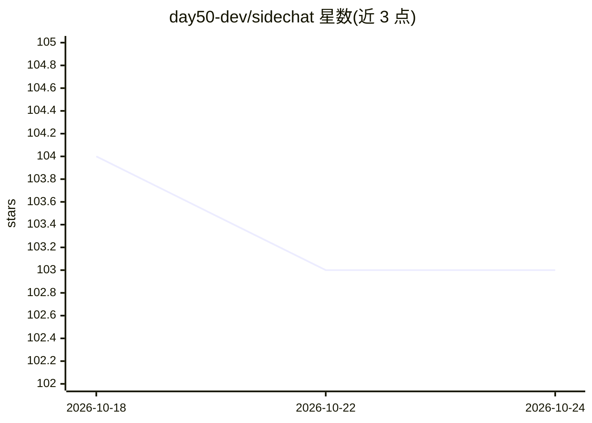

# day50-dev/sidechat

⭐ 103 · Shell · MIT · 推送 2026-10-06 · [GitHub](https://github.com/day50-dev/sidechat) · [官网](https://day50.dev) · 组织维护

**给终端用户的 tmux 内 LLM 对话面板：在问题发生处诊断**

DAY50 套件中的 tmux AI 助手：以 LLM 对话面板形式附着于 tmux，在问题出现当场诊断。支持向上下文添加截图、多窗格堆叠、命令输出、外部上下文、记忆与多剪贴板读取；支持 tool calling（含不原生支持的模型）、MCP、agentic loops、上下文编辑与 /amnesia 选择性记忆摘要注入。服务器地址以列表维护可切换，兼容本地与远程端点（llcat 后端）。通过 curl 一键脚本或 ursh 安装，可自更新。

## 筛选速览

| 维度 | 判定 | 备注 |
|---|---|---|
| AI 角色 | `ai-native` | 本体是模型或模型工具 |
| 许可风险 | `permissive` | MIT |
| 部署形态 | `None` |  |
| 模型依赖 | — | README 未给出锁定关系 |
| 硬件要求 | — | 无带数字的原话,不猜 |
| 安装摩擦 | `low` | 无编译、无系统依赖或容器化 |
| 成熟度 | — | 结构信号不足 |

## 能力要点

- 截图、多窗格、命令输出、外部上下文、多剪贴板读取注入对话
- tool calling（含不原生支持的模型）、MCP、agentic loops 支持
- /amnesia 选择性记忆：fzf 选主题生成摘要注入新上下文
- 服务器地址列表化切换，支持本地与远程模型端点

## 适用场景

- 在 tmux 中遇到报错时即时把现场上下文交给 LLM 诊断
- 把命令输出、man 页片段、剪贴板内容管道进对话上下文
- 在多个自管模型服务器之间切换使用

## 场景标签

`AI 助手` · 领域:对话与助手

## 证据(README 行号)

> L1: A tmux-based AI assistant
> L7: **Sidechat**, part of the DAY50 suite of open-source tools for AI workflows, is an LLM conversation panel that helps
> L25:  * local and remote servers thanks to the llcat backend.

## 星数曲线

2026-10-18 104 → 2026-10-24 103（-1）

---
*卡片 v1 · prompt 1.4 · 生成 2026-10-23 · 置信度 high · 依据 README sha `bb7d60d44f6f` · [字段定义](../../DATASET.md)*
