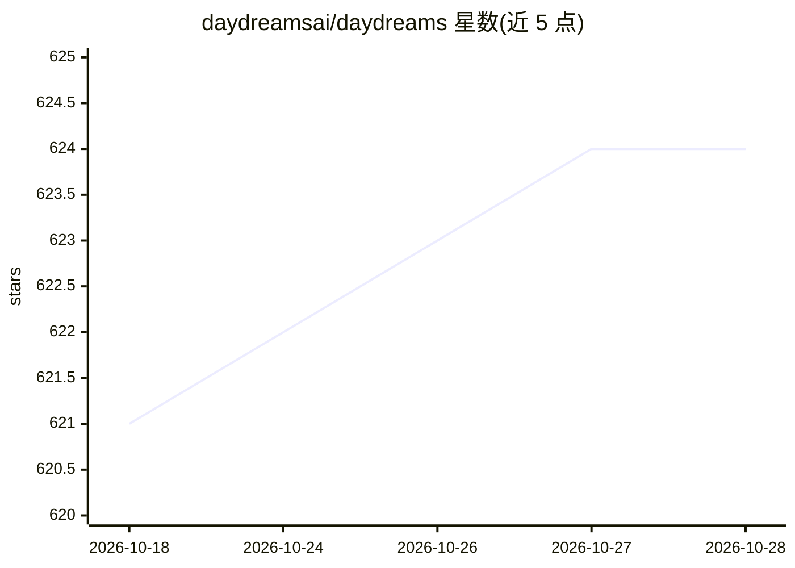

# daydreamsai/daydreams

⭐ 624 · TypeScript · MIT · 推送 2026-10-09 · [GitHub](https://github.com/daydreamsai/daydreams) · [官网](https://docs.daydreams.systems/) · 组织维护

**构建可组合上下文 AI agent 的 TypeScript 框架（已转向 Agentic Commerce）**

TypeScript 优先的 agent 框架，核心机制是可组合上下文架构：通过 .use() 将隔离的状态化工作区组合为复杂 agent，配套双层记忆持久化、类型安全 action、原生 MCP 扩展与 Discord/Twitter/Telegram 等平台扩展，运行于 Node.js/浏览器/Deno/Bun/edge。另提供 Dreams Router 统一模型网关，经 OpenAI/Anthropic/Google/Groq/xAI 等访问模型并支持 x402/USDC 按次付费。README 顶部声明本框架已非核心方向，功能过时，推荐使用 lucid-agents 与 Pi agent harness。

## 筛选速览

| 维度 | 判定 | 备注 |
|---|---|---|
| AI 角色 | `ai-ecosystem` | LLM/agent 周边工具 |
| 许可风险 | `permissive` | MIT |
| 部署形态 | `library` | 以包/库形式分发 |
| 模型依赖 | — | README 未给出锁定关系 |
| 硬件要求 | — | 无带数字的原话,不猜 |
| 安装摩擦 | `low` | 无编译、无系统依赖或容器化 |
| 成熟度 | — | 结构信号不足 |

## 能力要点

- 可组合上下文架构：.use() 组合隔离工作区
- 原生 MCP 集成扩展连接外部工具
- 双层记忆（工作记忆/上下文记忆）跨会话持久化
- Dreams Router 统一 API 访问多家模型并支持 x402 微支付

## 适用场景

- 用 TypeScript 构建带持久记忆的多场景 agent
- 通过 MCP 服务器为 agent 接入文件系统、数据库等外部工具
- 经统一网关按次付费调用多厂商模型
- 为 Discord/Twitter/Telegram 构建平台 bot

## 场景标签

`Agent 框架` `模型网关` · 领域:Agent 开发

## 证据(README 行号)

> L3: # Daydreams - AI Agent Framework
> L39: Daydreams is the **first AI framework with composable contexts** - isolated
> L73: import { createDreams, context, action } from "@daydreamsai/core";

## 星数曲线

2026-10-18 621 → 2026-10-28 624（+3）

---
*卡片 v1 · prompt 1.4 · 生成 2026-10-21 · 置信度 high · 依据 README sha `9298f56f433e` · [字段定义](../../DATASET.md)*
