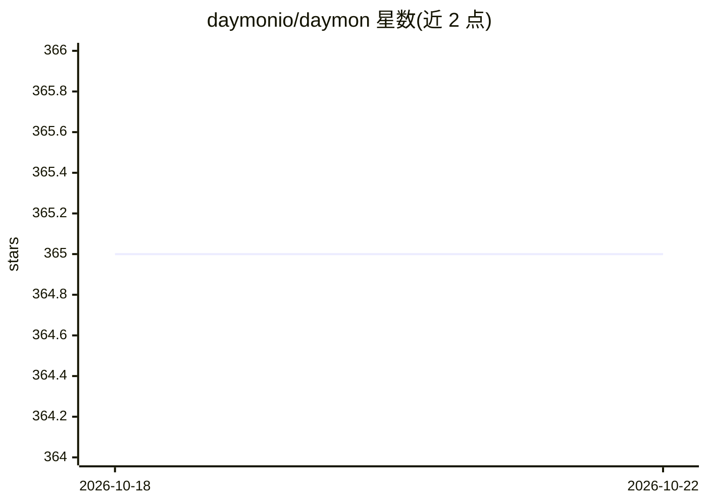

# daymonio/daymon

⭐ 365 · TypeScript · MIT · 推送 2026-10-02 · [GitHub](https://github.com/daymonio/daymon) · [官网](http://daymon.io) · 组织维护

**让 Claude 7×24 后台运行的本地桌面调度与记忆工具**

Electron 桌面应用（macOS/Windows/Linux 菜单栏驻留），接入已有的 Claude Desktop 或 Claude Code 订阅，为其补充定时任务调度、持久记忆（SQLite 知识图谱+本地嵌入）、命名 Worker 角色（9 个模板）、文件监视与任务自改进能力。无需 API key，全部本地运行，数据存于可检查的 SQLite 文件。通过 Homebrew、安装包或源码构建安装，首次启动自动配置 Claude。声明与 Anthropic 无隶属关系。

## 筛选速览

| 维度 | 判定 | 备注 |
|---|---|---|
| AI 角色 | `ai-ecosystem` | LLM/agent 周边工具 |
| 许可风险 | `permissive` | MIT |
| 部署形态 | `desktop` | 安装包/桌面程序 |
| 模型依赖 | locked-api |  |
| 硬件要求 | — | 无带数字的原话,不猜 |
| 安装摩擦 | `low` | 无编译、无系统依赖或容器化 |
| 成熟度 | — | 结构信号不足 |

## 能力要点

- 定时任务、持久记忆、Worker 角色、文件监视四大能力接入现有 Claude 订阅
- 无 API key、无云端，数据为本地 SQLite 文件
- 9 个 Worker 模板（研究员、代码审查员等）
- 提供 22 个 daymon_* 工具供 Claude 调用

## 适用场景

- 定时让 Claude 抓取新闻、做代码审查等后台任务
- 让 Claude 记住项目与个人偏好并跨会话使用
- 监视下载文件夹等目录并自动执行操作

## 场景标签

`AI 助手` `Agent 记忆` · 领域:Agent 开发

## 证据(README 行号)

> L16: Scheduled tasks, persistent memory, background automation. No API keys. No cloud. Runs on your Mac, Windows, or Lin
> L100: Daymon is a desktop app for macOS, Windows, and Linux that lives in your menu bar (system tray on Windows). It giv

## 星数曲线

2026-10-18 365 → 2026-10-22 365（+0）

---
*卡片 v1 · prompt 1.4 · 生成 2026-10-21 · 置信度 high · 依据 README sha `71f314f56460` · [字段定义](../../DATASET.md)*
