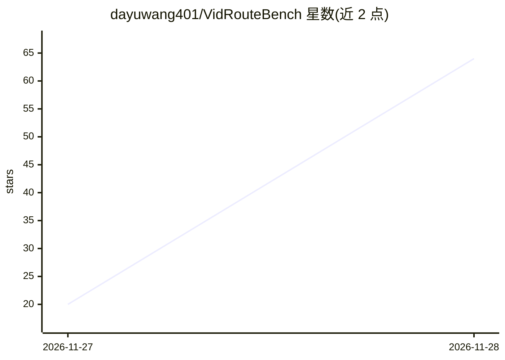

# dayuwang401/VidRouteBench

⭐ 64 · Python · Apache-2.0 · 推送 2026-11-26 · [GitHub](https://github.com/dayuwang401/VidRouteBench) · [官网](https://arxiv.org/abs/2611.28099) · 个人维护

**预算约束下文生图视频模型路由的评测基准（16 条 arm）**

面向预算化 text-to-video 路由的基准数据集与评测框架：收录 16 条 arm（7 个开源模型家族×采样配置），实测单条成本跨度 121 倍，附带 1,625 条分组 prompt 与 26,928 条已标注片段，冻结质量目标按人类成对偏好校准。提供三个任务协议（预算路由、OPMU 冷启动、多效用场景）与冻结的评测驱动，方法以单文件接入 harness。所有片段已生成并打分，开发与评测在 CPU 上秒至分钟级完成，无需 GPU。

## 筛选速览

| 维度 | 判定 | 备注 |
|---|---|---|
| AI 角色 | `ai-knowledge` | 知识聚合/清单类 |
| 许可风险 | `permissive` | Apache-2.0 |
| 部署形态 | `library` | 以包/库形式分发 |
| 模型依赖 | — | README 未给出锁定关系 |
| 硬件要求 | — | 无带数字的原话,不猜 |
| 安装摩擦 | `low` | 无编译、无系统依赖或容器化 |
| 成熟度 | `idea` | |

## 能力要点

- 16 arms（7 个模型家族）、26,928 条已标注 (prompt, arm, seed) 片段
- 冻结质量目标经人类成对偏好校准，附 12 原始/9 可辨识质量维度分数
- 三任务协议：预算路由、OPMU 冷启动、多效用 Pareto 评测
- 全数据预生成并打分，路由方法开发与评测仅需 CPU

## 适用场景

- 在给定预算下为 prompt 选择视频生成 arm 并评估路由收益
- 评测新模型家族只有少量标注时的冷启动路由方法
- 按多效用方向检验方法对 prompt-agnostic hull 的 Pareto 支配

## 场景标签

`模型评测` · 领域:评测与运维

## 证据(README 行号)

> L3: **A benchmark for budgeted text-to-video routing, OPMU (one probe set for many utilities), and a finding:
> L28: **No GPU needed.** All clips are already generated and scored. Developing and evaluating a router or a
> L20: - **1,625 grouped prompts** from VBench, VBench-2.0 and TA-Hard, with 26,928 labelled (prompt, arm, seed) clips.

## 星数曲线

2026-11-27 20 → 2026-11-28 64（+44）

---
*卡片 v1 · prompt 1.4 · 生成 2026-11-27 · 置信度 high · 依据 README sha `f20292729adf` · [字段定义](../../DATASET.md)*
