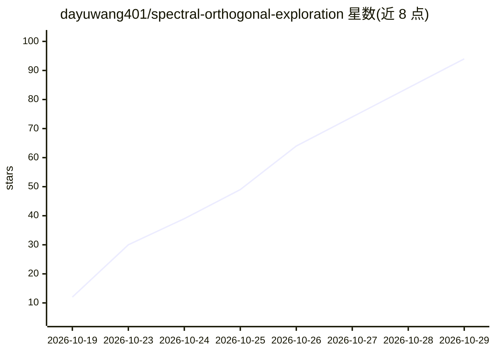

# dayuwang401/spectral-orthogonal-exploration

⭐ 94 · Python · MIT · 推送 2026-07-07 · [GitHub](https://github.com/dayuwang401/spectral-orthogonal-exploration) · [官网](https://aclanthology.org/2026.acl-long.761.pdf) · 组织维护

**ACL 2026 论文官方代码：训练无关的推理时扩展方法 SOE**

Baidu 与南洋理工作者团队的论文官方实现（ACL 2026 Oral）。SOE 是无需训练的推理时（test-time scaling）框架：用较弱的 Student 模型作为正交探针，通过 Micro-SVD 估计 Teacher 模型的低秩偏差流形，将最正交的探针拼入上下文，缓解 LLM 数学推理中的 Reasoning Collapse。以 vLLM 为推理后端，流程分四步脚本（基线生成、失败过滤、SOE 干预、最终评估），需从 HuggingFace 下载 Teacher/Student 模型（如 Qwen3-4B 与 Gemma-3-4B）。要求 Python 3.10+、PyTorch 2.0+ 与 CUDA GPU（步骤 3 支持多卡数据并行）。

## 筛选速览

| 维度 | 判定 | 备注 |
|---|---|---|
| AI 角色 | `ai-ecosystem` | LLM/agent 周边工具 |
| 许可风险 | `permissive` | MIT |
| 部署形态 | `library` | 以包/库形式分发 |
| 模型依赖 | local-ok | 支持本地模型 |
| 硬件要求 | — | 无带数字的原话,不猜 |
| 安装摩擦 | `medium` | 含编译或系统依赖之一 |
| 成熟度 | — | 结构信号不足 |

## 能力要点

- 弱 Student 模型作为正交探针干预强 Teacher 的推理（weak-to-strong）
- Micro-SVD 估计偏差流形并选取最正交探针拼接上下文
- 四步脚本流水线，基于 vLLM 运行，步骤 3 支持多 GPU 数据并行
- 在 AIME/MATH-500/OlympiadBench/Omni-Math 等基准上评估 Pass@16

## 适用场景

- 复现论文中 SOE 方法的实验结果
- 在数学推理基准上评估 Teacher-Student 组合的推理时扩展效果
- 研究推理坍缩现象与正交探针干预机制

## 场景标签

 · 领域:LLM 推理/研究代码

## 证据(README 行号)

> L16: **Spectral Orthogonal Exploration (SOE)** is a **training-free, inference-time (test-time scaling)** framework that
> L110: Core mechanism: estimate the Teacher's bias manifold (Micro-SVD), generate Student probes, and stitch the most ort
> L133: ├── step1_baseline_gen.py      # Step 1: Teacher greedy baseline generation (vLLM)

## 星数曲线

2026-10-19 12 → 2026-10-29 94（+82）

---
*卡片 v1 · prompt 1.4 · 生成 2026-10-24 · 置信度 mid · 依据 README sha `074d6cca8288` · [字段定义](../../DATASET.md)*
