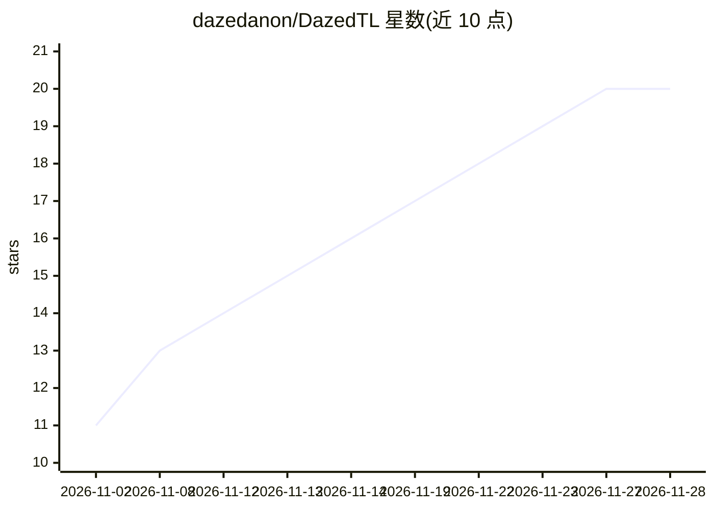

# dazedanon/DazedTL

⭐ 20 · Python · MIT · 推送 2026-11-11 · [GitHub](https://github.com/dazedanon/DazedTL) · 个人维护

**面向玩家的 AI 游戏翻译工具，支持 RPG Maker 系列引导式翻译**

DazedTL 是运行在 Windows/Linux 的游戏翻译工具，用用户自己的 AI provider 翻译游戏文本并写回游戏原文件，使游戏以目标语言游玩。提供三种方式：RPG Maker MV/MZ/VX Ace 的五阶段引导式翻译、任意游戏的助手主导翻译、以及手动提取文件翻译。配合 Claude Code、Codex 等 AI 编码助手处理名称、插件、图片等需调查的文本；翻译前给出费用估算，改动以检查点形式可撤销，并可导出干净游戏 ZIP 或补丁 ZIP。限制：目前仅支持不同文字体系语言对（如日↔英），同体系语言对（英↔西）尚不支持。

## 筛选速览

| 维度 | 判定 | 备注 |
|---|---|---|
| AI 角色 | `ai-native` | 本体是模型或模型工具 |
| 许可风险 | `permissive` | MIT |
| 部署形态 | `None` |  |
| 模型依赖 | locked-api |  |
| 硬件要求 | — | 无带数字的原话,不猜 |
| 安装摩擦 | `low` | 无编译、无系统依赖或容器化 |
| 成熟度 | `idea` | |

## 能力要点

- 三种翻译方式：五阶段引导（RPG Maker MV/MZ/VX Ace）、助手主导（任意游戏）、手动
- 将名称/插件/图片等任务交给 AI 编码助手，改动经检查后应用
- API 翻译前显示费用估算，确认后才扣费
- Text QA 由助手复查翻译并试玩 MV/MZ 游戏修复问题；所有改动可撤销

## 适用场景

- 我想把日文 RPG Maker 游戏翻译成英文来玩
- 我有一个非 RPG Maker 的游戏，想用 AI 助手整本翻译
- 我想把翻译结果做成补丁 ZIP 分享给其他玩家

## 场景标签

 · 领域:游戏/本地化工具

## 证据(README 行号)

> L21: DazedTL translates a game's text with your AI provider and writes it back into the game's own files, so the game it
> L69: - An API key from OpenAI, Anthropic, Google Gemini, Mistral, Kimi, DeepSeek, OpenRouter or OpenCode, or a local mod

## 星数曲线

2026-11-02 11 → 2026-11-28 20（+9）

---
*卡片 v1 · prompt 1.4 · 生成 2026-11-18 · 置信度 high · 依据 README sha `363b747c6d0b` · [字段定义](../../DATASET.md)*
