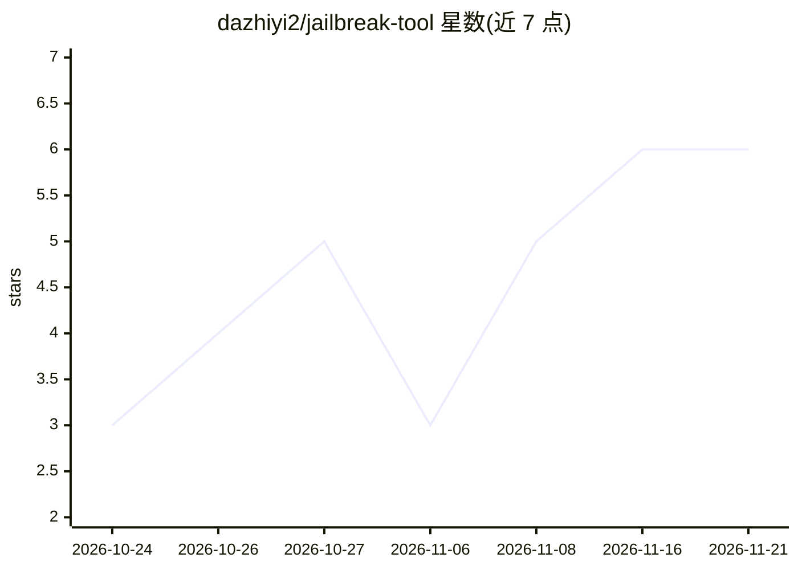

# dazhiyi2/jailbreak-tool

⭐ 6 · C# · MIT · 推送 2026-10-23 · [GitHub](https://github.com/dazhiyi2/jailbreak-tool) · 个人维护 · 中文 README

**给本机 AI 客户端注入提示词并从日志验证生效的工具**

面向本机已安装的 AI 客户端（DeepSeek Harness / ZCode / opencode）的注入工具：修改客户端读取的系统提示词与上下文指令文件，并解析会话日志中的模型内部推理来判定注入是否真正生效。按目标实现适配器（补丁覆写或官方配置通道），支持 own/protocol 两套可切换注入文本；写入前强制备份、锚点唯一、幂等、可逐字节回滚。提供 WinUI 3 图形界面与 CLI，Windows 安装包每用户安装，工具本身不联网。

## 筛选速览

| 维度 | 判定 | 备注 |
|---|---|---|
| AI 角色 | `ai-ecosystem` | LLM/agent 周边工具 |
| 许可风险 | `permissive` | MIT |
| 部署形态 | `desktop` | 安装包/桌面程序 |
| 模型依赖 | locked-api |  |
| 硬件要求 | — | 无带数字的原话,不猜 |
| 安装摩擦 | `medium` | 含编译或系统依赖之一 |
| 成熟度 | — | 结构信号不足 |

## 能力要点

- 覆盖 DeepSeek Harness / ZCode / opencode 三个目标，适配器架构可扩展新客户端
- 读会话日志中的推理原文，按三级判据区分"装上了"与"生效了"
- 写入纪律：锚点唯一、fail-closed、marker 幂等、备份与逐字节可证明回滚
- own/protocol 两套注入方案界面切换，B 套原文以 sha256 自检断言

## 适用场景

- 验证注入到 AI 客户端的提示词在会话日志里是否真的生效
- 为本机 AI 客户端维护可回滚的策略文件补丁
- 批量管理多个客户端的注入状态与备份健康度

## 场景标签

`提示工程` · 领域:Agent 开发

## 证据(README 行号)

> L3: 作用于**本机自己安装的** AI 客户端：改它读到的系统提示词，改它读到的上下文指令文件，并读会话日志里的**模型内部推理**判断到底生效没有。
> L53: 目标是**适配器**：加一个客户端 = 加一个 `ITargetAdapter`，界面与引擎不动。
> L105: 装到 `%LOCALAPPDATA%\Programs\JailbreakTool`（图形界面 + `engine.exe` + `Jailbreak-CLI.cmd` + `docs\`），开始菜单建三项：**Jailbrea

## 星数曲线

2026-10-24 3 → 2026-11-21 6（+3）

---
*卡片 v1 · prompt 1.4 · 生成 2026-11-20 · 置信度 mid · 依据 README sha `c3d7a014938c` · [字段定义](../../DATASET.md)*
