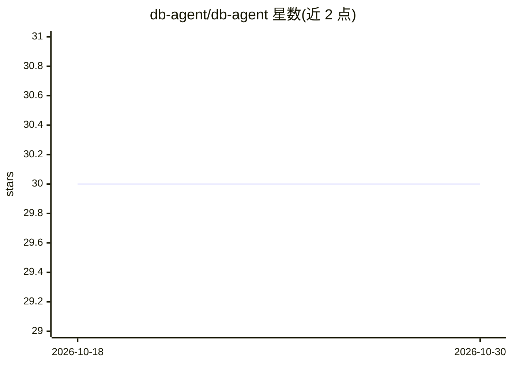

# db-agent/db-agent

⭐ 30 · JavaScript · Apache-2.0 · 推送 2026-10-27 · [GitHub](https://github.com/db-agent/db-agent) · [官网](https://becloudready.com/workshops) · 组织维护

**面向 Databricks/Postgres/Snowflake 的生产级 text-to-SQL 智能体**

Node.js/React 实现的自然语言转 SQL 系统：检索相关 schema 上下文，调用任意 OpenAI 兼容 LLM 生成 SQL，经 SELECT-only 安全层校验后在目标数据库执行并返回结果，中间步骤全部可见。支持本地一条命令运行、Docker 一键部署或原生部署到 Databricks Apps。SQL 后端包括 SQLite、PostgreSQL、MySQL、Lakebase 与 Unity Catalog；提供跨智能体共享的脱敏记忆（本地 JSONL 或 AWS S3 Vectors）、知识文件注入与基于结果集的基准测试。由 Databricks 注册合作伙伴 BeCloudReady 维护，并配套教学模块与培训。

## 筛选速览

| 维度 | 判定 | 备注 |
|---|---|---|
| AI 角色 | `ai-native` | 本体是模型或模型工具 |
| 许可风险 | `permissive` | Apache-2.0 |
| 部署形态 | `self-host` | docker 或自建部署 |
| 模型依赖 | local-ok | 支持本地模型 |
| 硬件要求 | — | 无带数字的原话,不猜 |
| 安装摩擦 | `low` | 无编译、无系统依赖或容器化 |
| 成熟度 | — | 结构信号不足 |

## 能力要点

- SELECT-only 安全层在 SQL 到达数据库前拦截写/管理操作
- 任意 OpenAI 兼容 LLM（Databricks Model Serving、OpenAI、Groq、Ollama、LM Studio）
- 跨智能体脱敏记忆：本地 JSONL 或 AWS S3 Vectors 共享存储
- 问题+标准 SQL 对的结果集基准测试，支持 UI 与 CI 集成

## 适用场景

- 用自然语言查询 Databricks 数仓或 Postgres/MySQL 数据库
- 在企业内部署带 SQL 安全防护的问答式数据查询应用
- 多个智能体（OLTP/OLAP）间共享查询建议而不共享数据

## 场景标签

`数据分析` `模型评测` · 领域:效率与自动化

## 证据(README 行号)

> L3: > An open-source **text-to-SQL AI agent** that converts natural language into safe SQL, with production deployment p
> L15: DB Agent is a minimal **natural-language-to-SQL system**. A user asks a question in plain English; DB Agent retriev

## 星数曲线

2026-10-18 30 → 2026-10-30 30（+0）

---
*卡片 v1 · prompt 1.4 · 生成 2026-10-26 · 置信度 high · 依据 README sha `15ba07d5b63a` · [字段定义](../../DATASET.md)*
