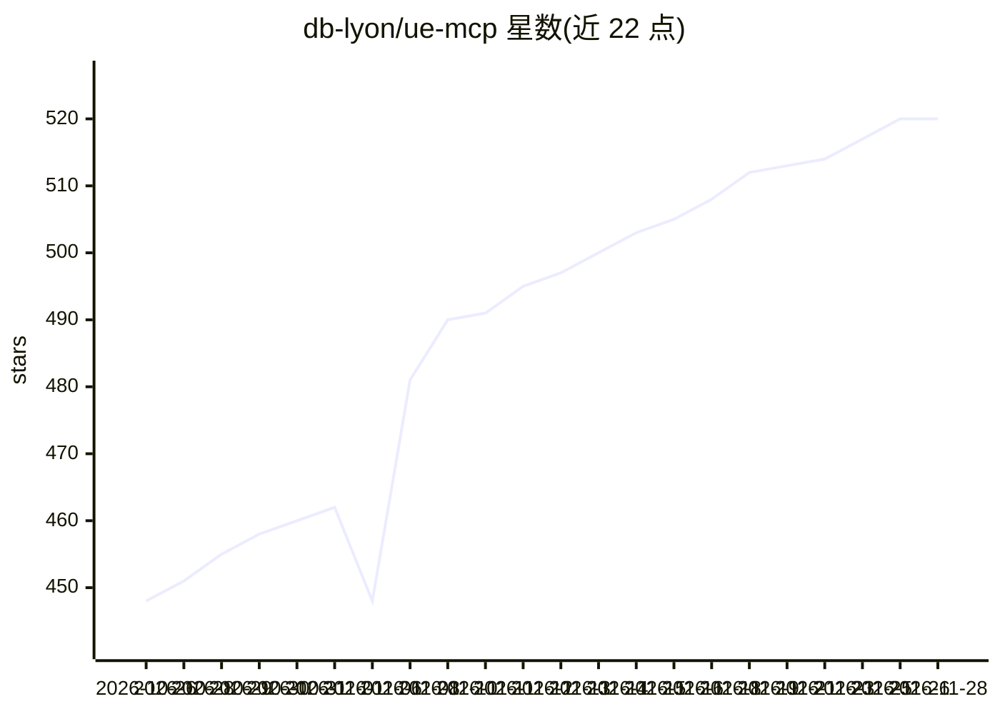

# db-lyon/ue-mcp

⭐ 520 · C++ · MIT · 推送 2026-11-27 · [GitHub](https://github.com/db-lyon/ue-mcp) · [官网](https://ue-mcp.com/) · 组织维护

**让 AI 助手通过 MCP 操作 Unreal Editor 的工具服务器**

面向 UE5 开发者的 Model Context Protocol 服务器，把 Unreal Editor 暴露为 AI 助手可调用的工具集：覆盖 Epic 原生工具（UE 5.8+）及自有的 1560+ 操作，共 3751+ 个动作，支持关卡、蓝图、材质、Niagara、地形等编辑操作。提供两种使用方式：内置 agent 的 Studio 桌面客户端（Windows）以及 npx 命令接入已有 AI 客户端。支持多步流程、回滚、写入保护与每轮检查点；离编辑器状态下仅支持部分只读操作。

## 筛选速览

| 维度 | 判定 | 备注 |
|---|---|---|
| AI 角色 | `ai-ecosystem` | LLM/agent 周边工具 |
| 许可风险 | `permissive` | MIT |
| 部署形态 | `library` | 以包/库形式分发 |
| 模型依赖 | — | README 未给出锁定关系 |
| 硬件要求 | — | 无带数字的原话,不猜 |
| 安装摩擦 | `low` | 无编译、无系统依赖或容器化 |
| 成熟度 | — | 结构信号不足 |

## 能力要点

- 3751+ 编辑器操作，含 Epic 全部 2191 个原生 Unreal 工具
- 支持将多个步骤串联为可复用流程，失败可回滚
- 写入保护与源控资产防护，Studio 提供每轮检查点与审批提示
- npx init 向导完成插件安装与 AI 客户端配置

## 适用场景

- 用自然语言让 AI 在打开的项目里搭建关卡、材质、VFX
- 让 AI 执行 Development 构建并汇报编译错误
- 用 Claude Code / Cursor 等客户端驱动 Unreal Editor 完成开发任务

## 场景标签

`编码 Agent` `AI 助手` · 领域:编码与开发

## 证据(README 行号)

> L13: UE-MCP is a free, open-source Model Context Protocol server for Unreal Engine 5. It connects AI assistants like Cla
> L55: Model Context Protocol is an open standard that lets AI assistants call external tools. UE-MCP is the tool server t

## 星数曲线

2026-10-26 448 → 2026-11-28 520（+72）

---
*卡片 v1 · prompt 1.4 · 生成 2026-11-28 · 置信度 high · 依据 README sha `85d4064d7af8` · [字段定义](../../DATASET.md)*
