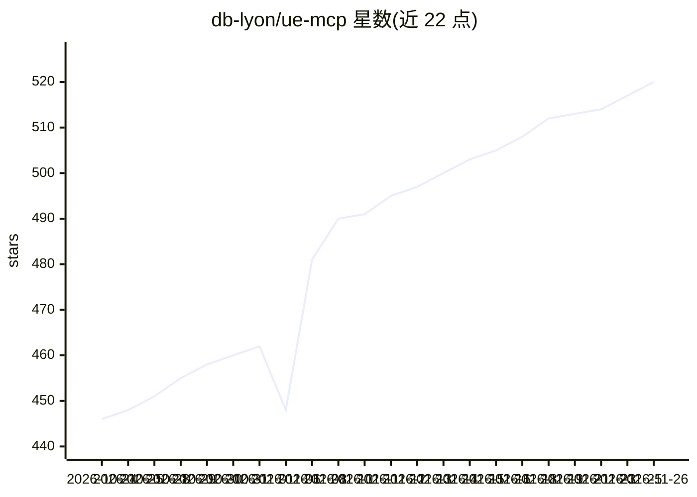

# db-lyon/ue-mcp

⭐ 520 · TypeScript · MIT · 推送 2026-11-25 · [GitHub](https://github.com/db-lyon/ue-mcp) · [官网](https://ue-mcp.com/) · 组织维护

**把 Unreal 编辑器暴露为 MCP 工具的 AI 开发工具包**

开源的 Model Context Protocol 服务器，将 Unreal Engine 5 编辑器封装为 3758+ 个操作（含 Epic 原生 2191 个工具），供 Claude、Cursor、Codex 等 AI 客户端调用，用自然语言完成关卡、蓝图、材质、Niagara、地形、构建等编辑器任务。提供两种使用方式：Windows 专属的 Studio 桌面客户端（内置 agent、逐轮 checkpoint 回滚与审批提示），或通过 npx 向导接入已有 AI 客户端。支持写保护、流程回滚；无编辑器打开时仅部分只读操作可用。

## 筛选速览

| 维度 | 判定 | 备注 |
|---|---|---|
| AI 角色 | `ai-ecosystem` | LLM/agent 周边工具 |
| 许可风险 | `permissive` | MIT |
| 部署形态 | `library` | 以包/库形式分发 |
| 模型依赖 | — | README 未给出锁定关系 |
| 硬件要求 | — | 无带数字的原话,不猜 |
| 安装摩擦 | `low` | 无编译、无系统依赖或容器化 |
| 成熟度 | — | 结构信号不足 |

## 能力要点

- 3758+ 编辑器操作：覆盖蓝图、材质、Niagara、PCG、GAS、Sequencer、构建等
- Studio 桌面客户端提供逐轮 checkpoint 与命令审批机制
- 写保护与流程回滚，源控资产可保护
- 支持同时驱动多个编辑器实例并可扩展插件

## 适用场景

- 用自然语言在打开的 UE 项目里搭建关卡与材质
- 让 AI 客户端执行构建并汇总编译错误
- 把重复编辑步骤链成可回滚的流程复用

## 场景标签

`编码 Agent` `AI 助手` `代码生成` · 领域:编码与开发

## 证据(README 行号)

> L13: UE-MCP is a free, open-source Model Context Protocol server for Unreal Engine 5. It connects AI assistants like Cla
> L55: Model Context Protocol is an open standard that lets AI assistants call external tools. UE-MCP is the tool server t

## 星数曲线

2026-10-24 446 → 2026-11-26 520（+74）

---
*卡片 v1 · prompt 1.4 · 生成 2026-11-26 · 置信度 high · 依据 README sha `6fc87e5c8706` · [字段定义](../../DATASET.md)*
