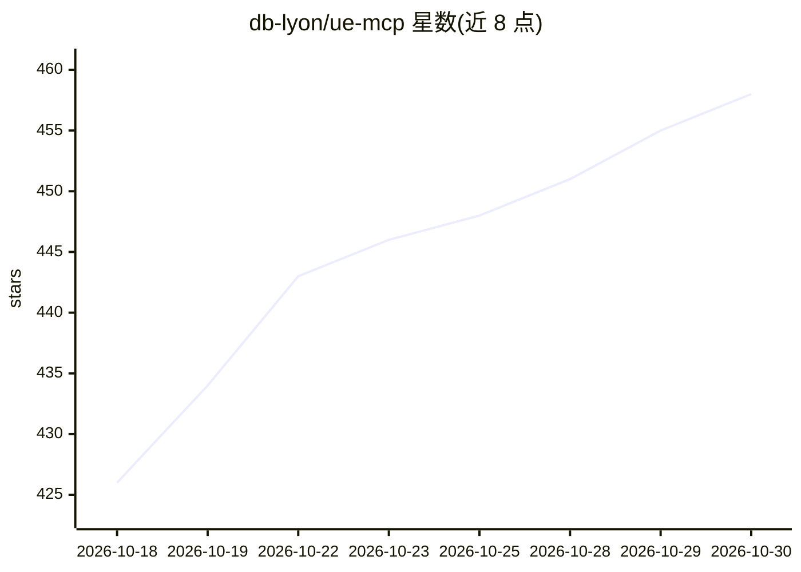

# db-lyon/ue-mcp

⭐ 458 · C++ · MIT · 推送 2026-10-29 · [GitHub](https://github.com/db-lyon/ue-mcp) · [官网](https://ue-mcp.com/) · 个人维护

**让 AI 助手读写 Unreal 编辑器的 MCP 服务器**

面向 Unreal Engine 开发者的 MCP 服务器：通过 Node.js 服务器、WebSocket/JSON-RPC 与编辑器内 C++ 桥接插件，向 AI 助手暴露 29 类工具、2040+ 个动作，覆盖蓝图、材质、关卡、动画、Niagara、PCG、GAS、Sequencer 等；UE 5.8+ 可进程内调用 Epic 官方 830 个工具。另提供 YAML 多步 flow 引擎、npm 插件扩展系统、写入防护与回滚机制。需 C++ 工具链编译桥接插件，支持 Windows/macOS/Linux。

## 筛选速览

| 维度 | 判定 | 备注 |
|---|---|---|
| AI 角色 | `ai-ecosystem` | LLM/agent 周边工具 |
| 许可风险 | `permissive` | MIT |
| 部署形态 | `library` | 以包/库形式分发 |
| 模型依赖 | — | README 未给出锁定关系 |
| 硬件要求 | — | 无带数字的原话,不猜 |
| 安装摩擦 | `low` | 无编译、无系统依赖或容器化 |
| 成熟度 | — | 结构信号不足 |

## 能力要点

- 29 类工具、2040+ 动作覆盖蓝图/材质/PCG/Niagara/GAS 等编辑器操作
- YAML flow 引擎支持步骤引用、重试、回滚与自定义 JS/TS 任务
- npm 插件系统可注入新动作或新类别
- 写入防护：可配置写守卫、源码控制门控、幂等约定

## 适用场景

- 用自然语言让 AI 助手搭建关卡、材质、蓝图等编辑器内容
- 把多步编辑器操作录制为 YAML flow 一键重放
- 在 CI 或代理工作流中通过 MCP 自动化 UE 项目构建与检查

## 场景标签

`工作流自动化` · 领域:效率与自动化

## 证据(README 行号)

> L10: **Unreal Engine Model Context Protocol Server** - gives AI assistants deep read/write access to the Unreal Editor t
> L16:     AI[AI Assistant] -->|stdio| MCP[MCP Server TypeScript / Node.js]
> L17:     MCP -->|WebSocket JSON-RPC| Plugin[C++ Bridge Plugin inside Unreal Editor]

## 星数曲线

2026-10-18 426 → 2026-10-30 458（+32）

---
*卡片 v1 · prompt 1.4 · 生成 2026-10-21 · 置信度 high · 依据 README sha `da0b02edc94f` · [字段定义](../../DATASET.md)*
