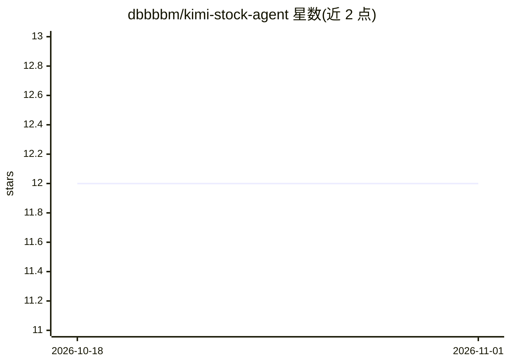

# dbbbbm/kimi-stock-agent

⭐ 12 · Python · 推送 2026-05-27 · [GitHub](https://github.com/dbbbbm/kimi-stock-agent) · 个人维护 · 中文 README

**个人记录 AI（Claude Code+Kimi）模拟炒股过程的项目**

以日记形式记录 AI 自主进行 A 股模拟交易的全过程：使用 Claude Code 配合 Kimi K2.6 模型，通过内置 5 个斜杠命令（分析、操作、更新持仓、每日/每周归档）驱动交易决策，另有 scheduler.py 支持定时更新、定时操作与持仓波动触发的自动化。README 声明未投入任何真实资金，仅用于记录 AI 学习过程，内容包括持仓明细、交易记录、风控设置与每日复盘。手动方式运行 run_once.sh 后与 Claude 对话。

## 筛选速览

| 维度 | 判定 | 备注 |
|---|---|---|
| AI 角色 | `ai-native` | 本体是模型或模型工具 |
| 许可风险 | `none` | — |
| 部署形态 | `None` |  |
| 模型依赖 | locked-api |  |
| 硬件要求 | — | 无带数字的原话,不猜 |
| 安装摩擦 | `low` | 无编译、无系统依赖或容器化 |
| 成熟度 | — | 结构信号不足 |

## 能力要点

- 内置 5 个命令：analysis/operate/update/daily_archieve/weekly_archieve
- scheduler.py 支持定时运行与持仓波动触发自动操作
- README 声明未投入真实资金，仅记录 AI 学习过程

## 适用场景

- 观察 AI 在股票交易决策中的实际表现
- 了解 agent 工作流如何驱动模拟盘交易与归档
- 跟踪每日持仓、风控与复盘记录

## 场景标签

`金融量化` · 领域:学习与行业

## 证据(README 行号)

> L7: Claude code + kimi k2.6
> L17: - `\analysis` 只做出分析，不操作

## 星数曲线

2026-10-18 12 → 2026-11-01 12（+0）

---
*卡片 v1 · prompt 1.4 · 生成 2026-11-01 · 置信度 mid · 依据 README sha `9fa7a0cf7bd1` · [字段定义](../../DATASET.md)*
